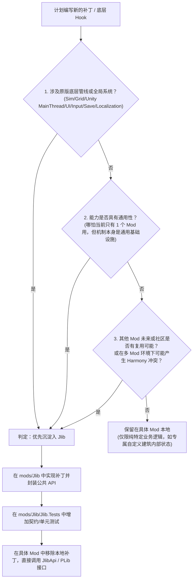

# Jlib 优先打补丁与能力复用准则 (Jlib-First Patching)

本技能确立了 OniMods 项目中**创建补丁与底层拦截时的核心工程原则**：
当需要创建新的游戏补丁（Harmony Patch、Detour、Mono P/Invoke Hook 等）时，**必须优先思考并将其沉淀到共享前置库 `Jlib` 中以实现多 Mod 复用；在 Jlib 中对外暴露标准 API，下游 Mod 直接调用该接口，严禁各自打私有补丁。**

---

## 核心设计哲学

1. **共享前置单一事实来源 (Single Source of Truth)**
   - 游戏原版的类（如 `Game`、`World`、`Grid`、`Sim`、`KScreen`、`SaveLoader` 等）如果被多个下游 Mod 各自用 Harmony 拦截同一方法，容易造成补丁执行顺序竞争、性能劣化及排障黑洞。
   - 凡涉及游戏基础机制、全局状态、主线程通信或跨 Mod 协同的逻辑，**统一由 `Jlib` 集中挂载底层补丁**，并向外暴露强类型的 C# 接口、事件（Events）或提供者注册点（Provider Registry）。

2. **下沉优先，接口消费**
   - 下游 Mod（如 `CycleTrim`、`OniMcp`、`OniOnline` 或新孵化的模组）定位为业务实现与**消费者**。
   - 消费者 Mod **只调用 Jlib 公开的 API**，不复制补丁实现，不使用 ILRepack 内嵌 Jlib/PLib，保持分发包轻量且解耦。

---

## 决策树：新补丁是否应当进 Jlib？

当准备在代码中写下 `[HarmonyPatch]` 或使用 `Detour` 时，按以下决策树判定：



### 应当进 Jlib 的典型场景
- **主线程执行与帧调度**：如 `JlibDispatcher` / `JlibApi.RunOnMainThread`。
- **底层原生动态库映射与拦截**：如 `JlibApi.ReplaceSimDll`、`MonoDllMap` 替换。
- **全局网格 / 元素数据扩展**：如多组分流体 `Jlib.Multicomponent` 及其补丁 `MulticomponentPatches`。
- **游戏选项与配置界面**：使用 `PeterHan.PLib.Options`（`POptions`）。
- **通用建筑注册与范围渲染**：使用 `PeterHan.PLib.Buildings`（`PBuildingManager`）。
- **按键绑定与输入拦截**：使用 `PeterHan.PLib.Actions`（`PActionManager`）。
- **生命周期钩子与 Mod 注册**：`JlibApi.RegisterConsumer`、`PUtil.RegisterModAssembly`。

---

## 落地实施规范

### 1. Jlib 侧的实现规范 (`mods/Jlib`)

1. **命名空间与分层**：
   - 核心运行时与静态入口统一收敛在 `Jlib.Runtime`（如 `JlibApi`）。
   - 特定能力模块独立子命名空间（如 `Jlib.Multicomponent`、`PeterHan.PLib.*`）。
2. **暴露标准化接口**：
   - 避免直接暴露裸露的 Harmony 补丁类；应封装成类似 `JlibApi.InstallXxxPatches()` 或在 Jlib 加载时自动统筹。
   - 对外提供 `Action` / `Func` 订阅、回调注册、或者接口实现注入（如 `RegisterProvider(IProvider)`）。
3. **单分支严守规范**：
   - 严格遵循 `AGENTS.md`：`mods/Jlib` 统一在 `main` 分支迭代，**禁止创建旁路分支**，严禁让 submodule/子仓库处于游离 HEAD。

### 2. 下游 Mod 侧的接入规范

1. **项目依赖声明**：
   - 必须通过 `LIghtJUNction.Jlib` NuGet 包或 `Directory.Build.props` 声明引用。
   - 设置 `ExcludeAssets="runtime"` 或 `Private="false"`，**严禁将 Jlib 打包进下游 Mod 的发布目录**。
2. **启动期握手与守卫**：
   - 消费者 Mod 在入口（如 `UserMod2.OnLoad`）中先校验 Jlib 运行时兼容性：
     ```csharp
     JlibApi.RequireCompatibility(requiredAbi: 1, minimumVersion: "0.3.0");
     JlibApi.RegisterConsumer(typeof(MyMod).Assembly, mod);
     ```
3. **调用高层接口**：
   - 直接调用 `JlibApi.*`，不得重复实现相同机制的 Harmony 补丁。

---

## 经典对比范例

### 范例 1：主线程任务调度 (MainThread Dispatch)
- ❌ **错误做法**：在每个 Mod 中写一个 `[HarmonyPatch(typeof(Global), "Update")]`，各自维护私有的 `Queue<Action>`，多次 Hook 原生 Update 造成开销和不可控的执行顺序。
- ✅ **正确做法**：统一使用 Jlib 的 `JlibDispatcher`：
  ```csharp
  // 任何下游 Mod 需要切主线程时：
  JlibApi.RunOnMainThread(() => {
      // 安全操作 Unity 对象
  });
  ```

### 范例 2：底层动态库 Hook (Native / SimDLL)
- ❌ **错误做法**：在 CycleTrim 或其他 Mod 里私自用反射甚至非标准 Mono API 绕过受支持的原生库映射接口。
- ✅ **正确做法**：将通用 MonoDllMap 统一沉淀入 `Jlib.Runtime.GameComponentReplacement`，在下游 Mod 中一行调用：
  ```csharp
  JlibApi.ReplaceSimDll(gameAssembly, customSimDllPath);
  ```

### 范例 3：多组分网格数据与扩展 (Multicomponent Access)
- ❌ **错误做法**：在独立 Mod 中硬写 Harmony Patch 劫持 `Grid.Element`，导致其他 Mod 无法感知甚至崩溃。
- ✅ **正确做法**：在 Jlib 维护 `MulticomponentPatches`，下游 Mod 通过 `MulticomponentCellAccess.RegisterProvider(...)` 接入数据源。

---

## 验证与验收清单

当完成一项本应属于补丁的开发时，确认以下闭环：

- [ ] 是否确认该底层需求已被抽象进 `mods/Jlib` 而非散落在具体 Mod？
- [ ] Jlib 是否暴露了清晰、健壮的公共 API（如 `JlibApi` 或相应命名空间）？
- [ ] 下游 Mod 是否完全去除了冗余的私有 Harmony 补丁，改由直接调用 Jlib 接口？
- [ ] `mods/Jlib` 是否保持在 `main` 分支且无分支分叉？
- [ ] 运行 `dotnet build` 或 `onim build` 确认两端均正常编译并通过契约检查。
