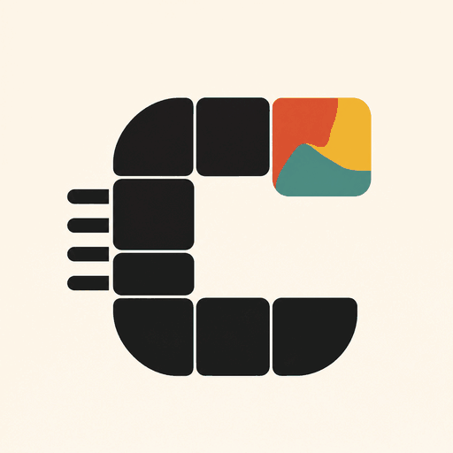
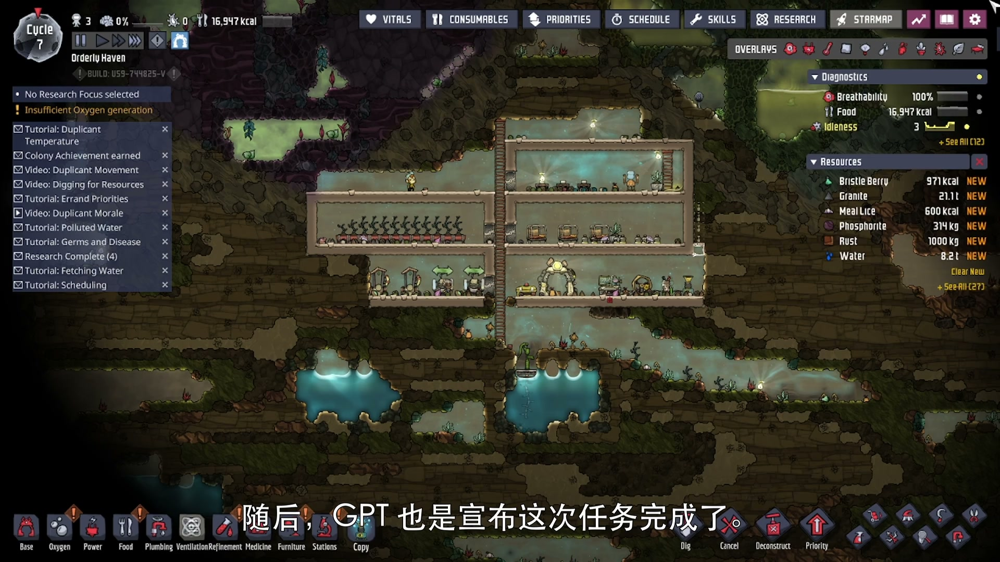
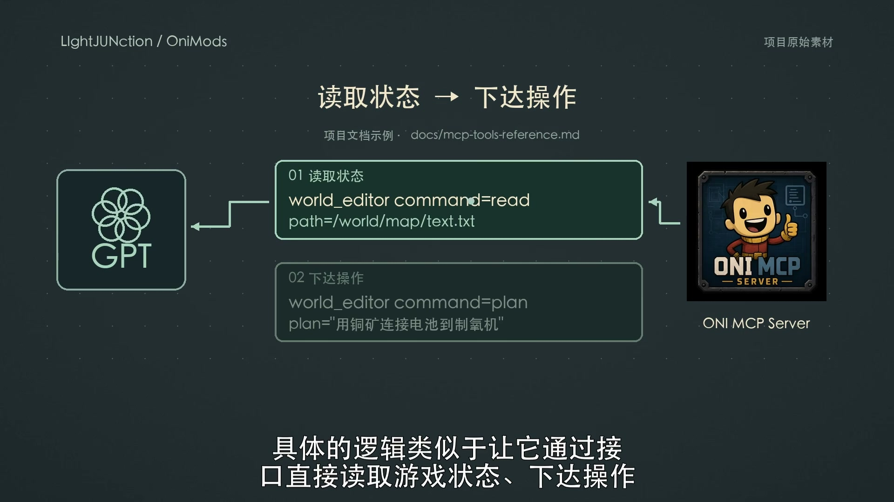
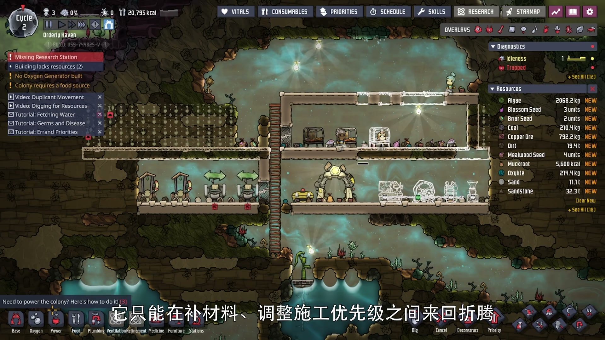

> This project is developed by AI through a fully automated, end-to-end closed-loop workflow.
>
> **Typing code by hand is human abuse! Protect humans!**

<div align="center">
  <h1>OniMods</h1>
  <p><strong>Build, ship, optimize, and automate Oxygen Not Included mods from one workspace.</strong></p>
  <p>Rust developer tooling · .NET mods · MCP colony operations · performance and multiplayer experiments</p>

  [](LICENSE)
  [](https://github.com/LIghtJUNction/OniMods/stargazers)
  [](https://github.com/LIghtJUNction/OniMods/issues)
  [](https://github.com/LIghtJUNction/OniMods/commits/main)

  [简体中文](README_ZH.md) · [onim CLI](README-onim.md) · [OniMcp docs](mods/OniMcp/README_EN.md) · [Architecture](docs/architecture-and-principles.md)
</div>

<p align="center">
  <a href="mods/OniMcp/README_EN.md"></a>
  <a href="mods/CycleTrim/README.md"></a>
</p>

<p align="center">
  <a href="mods/OniOnline/README.md"></a>
  <a href="mods/Jlib/README.md"></a>
</p>

## See it working

> **Test attribution: The screenshots below are from a video of someone else's OniMcp test, not a test by the project author.**

[](https://b23.tv/isOd72t)

The linked gameplay demo shows an MCP client reading colony state and issuing bounded operations for construction and farming. It is a real integration run, including the failures encountered along the way—not a scripted product animation.

| Read state and plan · 00:18 | Construction in progress · 02:10 |
| --- | --- |
|  |  |

## What ships here

| Component | What it does | Start here |
| --- | --- | --- |
| **onim** | Creates, builds, installs, inspects and publishes ONI mods | [CLI guide](README-onim.md) |
| **OniMcp** | Exposes colony state and bounded game operations to MCP clients | [English](mods/OniMcp/README_EN.md) · [中文](mods/OniMcp/README.md) · [Rust CLI](docs/oni-mcp-cli.md) |
| **CycleTrim** | High-risk experiment. A Rust SimDLL (OniSim) replaces the official one at startup; thermal diffusion and eligible gas/liquid regions already run on Vulkan (wgpu) GPU passes, with experimental multicomponent cells. Speed first | [Module docs](mods/CycleTrim/README.md) · [GPU status](mods/CycleTrim/OniSim/gpu/README.md) |
| **OniOnline** | Multiplayer framework with lobby chat; other gameplay ships as separate mods | [Module docs](mods/OniOnline/README.md) |
| **Jlib** | A standalone shared PLib-compatible prerequisite library ([Workshop 3835083839](https://steamcommunity.com/sharedfiles/filedetails/?id=3835083839)) | [Source and install notes](mods/Jlib/README.md) |
| **OniModTemplate** | A reusable starting point for a new ONI mod | [Template](mods/OniModTemplate/README.md) |
| **OniHarness** | Headless/real-game test harness: arbitrary-geometry physics maps, building simulation, mod install tests | [Notes](docs/oniharness.md) · [Submodule](tools/OniHarness/) |
| **oni-skills** *(optional)* | Colony engineering notes for SPOM, cooling, ranching and power | [Guides](oni-skills/) · [GitHub](https://github.com/LIghtJUNction/oni-skills) |

The repository is intentionally split into two layers: `onim` provides the repeatable development workflow; `mods/` contains independently scoped game modules. Every mod here is developed, tested, and published with onim: `onim dev`, `onim build`, `onim publish`. Project: [OniMods](https://github.com/LIghtJUNction/OniMods).

## Quick start

Requirements: Rust, a .NET SDK, a local Oxygen Not Included installation, and the normal packaging tools (`unzip` and `tar`).

```bash
cargo install --path .
onim setup
onim doctor
onim init MyMod --author YourName --desc "Your mod description"
onim dev -m MyMod
```

`onim setup` discovers the game path and can generate local build configuration. If you configure it manually:

```bash
cp Directory.Build.props.example Directory.Build.props
# Set OniGamePath in Directory.Build.props
```

The normal lifecycle is deliberately small:

```text
init → dev → inspect → install → publish
```

| Command | Result |
| --- | --- |
| `onim init <name>` | Scaffold a mod from the maintained template |
| `onim dev -m <name>` | Build and install into the game's `mods/Dev` directory |
| `onim info` | Inspect installed Dev, Local and Steam modules |
| `onim install -m <name>` | Produce and install a release build (`--release OWNER/REPO` / `--repo OWNER/REPO` install from GitHub) |
| `onim publish -m <name>` | Upload a single-file Legacy ZIP through the native publisher (`--dry-run`, `--preflight`, `--create`, `--resume`, `--update-preview`, `--gui`) |
| `onim workshop …` | Search, install and uninstall Workshop items; `workshop page show/set` edits an owned page without uploading a ZIP |
| `onim uninstall -m <name>` | Remove a selected Dev/Local installation |

`onim dev` only rewrites `mods.json` when configuration actually changes, retains the latest five valid backups, and reports cleanup failures separately. Installation validates the new archive, DLL and metadata before replacing the previous copy. Only one installation per `staticID` stays active across Local, Dev and Workshop; verified duplicates move to `mods/.onim-recovery`, and prerequisites such as Jlib are ordered before their consumers.

> **Workshop safety:** never publish with SteamCMD `workshop_build_item` or `SteamUGC.SetItemContent`. Directory-mode uploads irreversibly break ONI items. See [Steam publishing](docs/steam-publishing.md).

## OniMcp: the operational boundary

OniMcp is an MCP-native operations layer, not an unrestricted automation backdoor. Its public surface is grouped by intent:

- `world_editor` — virtual-file SEARCH/REPLACE workflows for save-like artifacts;
- `game_control` — pause, speed, save and load orchestration;
- `navigation_control` — camera, overlays and screenshots;
- `building_control` — building and utility operations;
- `orders_control` — dig, sweep, clean and deconstruct orders;
- `server_control` — manifests, diagnostics, sessions and screenshot lifecycle.

Critical operations remain bounded and should be preceded by read-only inspection and explicit task framing. The project does not claim that autonomous play replaces human oversight.

> **Pre-1.0 compatibility:** OniMcp may still introduce breaking API changes. Pin exact versions for clients and plugins, then verify the live surface through `oni://tools/manifest` rather than assuming a README is the runtime contract.

## Repository map

```text
.
├── src/                         onim Rust CLI (+ oni-mcp client binary)
├── mods/
│   ├── OniMcp/                  MCP server mod
│   ├── CycleTrim/               GPU-first performance experiment
│   │   └── OniSim/              Rust SimDLL, wgpu/WGSL operators, Lean proofs
│   ├── OniOnline/               multiplayer framework, lobby and chat
│   ├── Jlib/                    shared PLib-compatible library (submodule)
│   └── OniModTemplate/          reusable mod scaffold
├── sdk/                         OniOnline.Framework SDK, Jlib.Bootstrap
├── examples/                    sample OniOnline gameplay mod
├── tools/                       OniHarness (submodule), Legacy ZIP Steam publisher
├── tests/ · benchmarks/         host regressions and ablation benchmarks
├── oni-skills/                  optional colony engineering guides
├── docs/                        architecture, testing and publishing notes
├── scripts/                     verification and Legacy ZIP publishing helpers
├── Cargo.toml                   onim package definition
└── onim.toml                    workspace aliases and defaults
```

## Verification and contribution

Before opening a pull request:

Shipped mods depend on the standalone [Jlib](https://github.com/LIghtJUNction/Jlib) mod ([Steam Workshop](https://steamcommunity.com/sharedfiles/filedetails/?id=3835083839)). The source checkout uses the `mods/Jlib` submodule; in game, enable Jlib and keep it above its consumers.

```bash
onim doctor
python3 scripts/check_mods.py
```

The regression suite requires Python 3 and .NET SDK 10. Checks that need a locally installed game are documented separately in [Mod testing](docs/mod-testing.md).

Keep changes focused, update the affected changelog, and open an issue first when a proposal changes module boundaries or public MCP behavior.

## Releases and further reading

- [OniMcp changelog](mods/OniMcp/CHANGELOG.md)
- [CycleTrim changelog](mods/CycleTrim/CHANGELOG.md) · [OniSim progress](mods/CycleTrim/OniSim/docs/progress.md)
- [onim changelog](CHANGELOG-onim.md)
- [OniOnline](mods/OniOnline/README.md)
- [Jlib](mods/Jlib/README.md)
- [Template changelog](mods/OniModTemplate/CHANGELOG.md)
- [Steam publishing workflow](docs/steam-publishing.md)
- [Architecture and principles](docs/architecture-and-principles.md)
- [Open-source letter](docs/open-source-letter-en.md)

OniMcp development and agent testing consume model API credits. [Project donations](https://donate.lmm.best/?project=onimcp) support that work. An OpenAI-compatible endpoint is optional; OniMods does not require a specific provider.

## License

Original material that LIghtJUNction has the right to license is offered under [Agent Upstream License 1.0-draft.1](LICENSE). This custom draft is **not** an OSI-approved license.

Historical MIT releases retain their original permissions in [LICENSE.MIT](LICENSE.MIT). Third-party and adapted upstream material keeps its own terms; see [LICENSING.md](LICENSING.md). Agent contributors must also read [AGENTS.md](AGENTS.md) and [UPSTREAM.toml](UPSTREAM.toml).

## Pull requests

Low-quality human-written PRs will not be accepted. This includes, but is not limited to:

- Commits written entirely by humans.
- Code that is insufficiently defensive, fails to consider enough scenarios, or is excessively terse, showing obvious signs of human laziness.
- Any form of code typed entirely by hand.
