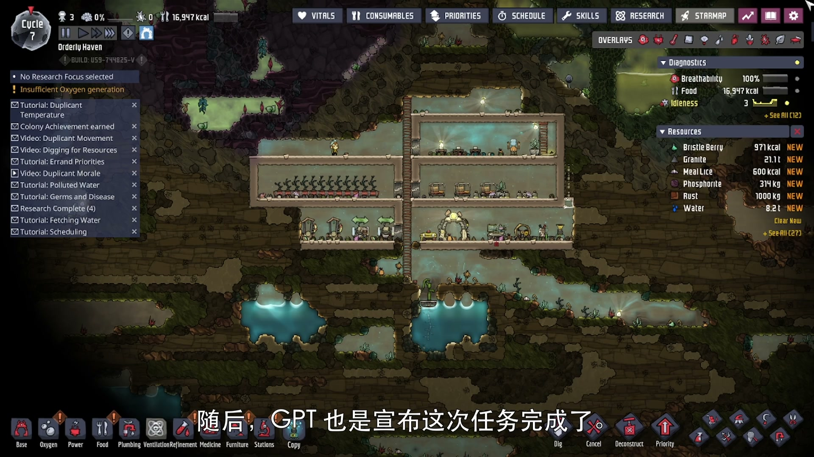
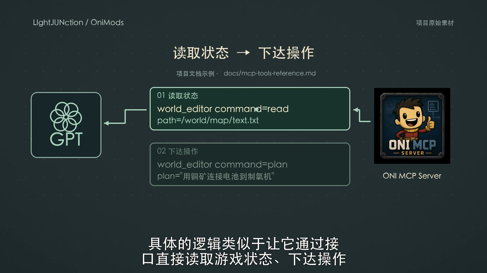
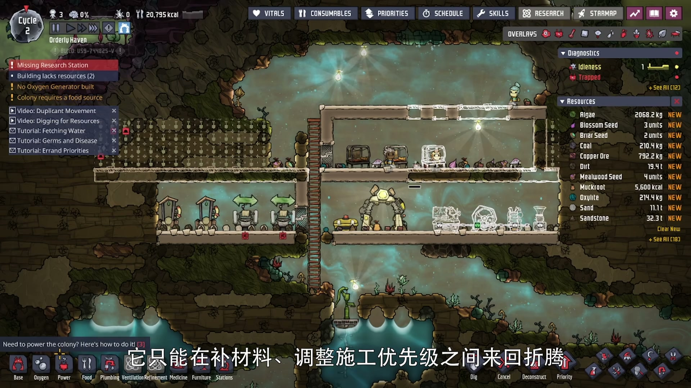

<div align="center">
  <h1>OniMods</h1>
  <p><strong>Build, ship, optimize, and automate Oxygen Not Included mods from one workspace.</strong></p>
  <p>Rust developer tooling · .NET mods · MCP colony operations · performance and multiplayer experiments</p>

  [](LICENSE)
  [](https://github.com/LIghtJUNction/OniMods/stargazers)
  [](https://github.com/LIghtJUNction/OniMods/issues)
  [](https://github.com/LIghtJUNction/OniMods/commits/main)

  [简体中文](README_ZH.md) · [onim CLI](README-onim.md) · [OniMcp docs](mods/OniMcp/README_EN.md) · [Architecture](docs/architecture-and-principles.md)
</div>

<p align="center">
  <a href="mods/OniMcp/README_EN.md"></a>
  <a href="mods/CycleTrim/README.md"></a>
</p>

## See it working

[](https://b23.tv/isOd72t)

The linked gameplay demo shows an MCP client reading colony state and issuing bounded operations for construction and farming. It is a real integration run, including the failures encountered along the way—not a scripted product animation.

| Read state and plan · 00:18 | Construction in progress · 02:10 |
| --- | --- |
|  |  |

## What ships here

| Component | What it does | Start here |
| --- | --- | --- |
| **onim** | Creates, builds, installs, inspects and publishes ONI mods | [CLI guide](README-onim.md) |
| **OniMcp** | Exposes colony state and bounded game operations to MCP clients | [English](mods/OniMcp/README_EN.md) · [中文](mods/OniMcp/README.md) |
| **CycleTrim** | Targets measured simulation hot paths with focused performance patches | [Module docs](mods/CycleTrim/README.md) |
| **OniOnline** | Experiments with multiplayer planets, chat and authorized observation | [Module docs](mods/OniOnline/README.md) |
| **OniModTemplate** | A reusable starting point for a new ONI mod | [Template](mods/OniModTemplate/README.md) |

The repository is intentionally split into two layers: `onim` provides the repeatable development workflow; `mods/` contains independently scoped game modules.

## Quick start

Requirements: Rust, a .NET SDK, a local Oxygen Not Included installation, and the normal packaging tools (`unzip` and `tar`).

```bash
cargo install --path .
onim setup
onim doctor
onim init MyMod --author YourName --desc "Your mod description"
onim dev -m MyMod
```

`onim setup` discovers the game path and can generate local build configuration. If you configure it manually:

```bash
cp Directory.Build.props.example Directory.Build.props
# Set OniGamePath in Directory.Build.props
```

The normal lifecycle is deliberately small:

```text
init → dev → inspect → install → publish
```

| Command | Result |
| --- | --- |
| `onim init <name>` | Scaffold a mod from the maintained template |
| `onim dev -m <name>` | Build and install into the game's `mods/Dev` directory |
| `onim info` | Inspect installed Dev, Local and Steam modules |
| `onim install -m <name>` | Produce and install a release build |
| `onim publish -m <name>` | Publish through the Steam Workshop workflow |
| `onim uninstall -m <name>` | Remove a selected Dev/Local installation |

`onim dev` only rewrites `mods.json` when configuration actually changes, retains the latest five valid backups, and reports cleanup failures separately. Installation validates the new archive, DLL and metadata before replacing the previous copy.

## OniMcp: the operational boundary

OniMcp is an MCP-native operations layer, not an unrestricted automation backdoor. Its public surface is grouped by intent:

- `world_editor` — virtual-file SEARCH/REPLACE workflows for save-like artifacts;
- `game_control` — pause, speed, save and load orchestration;
- `navigation_control` — camera, overlays and screenshots;
- `building_control` — building and utility operations;
- `orders_control` — dig, sweep, clean and deconstruct orders;
- `server_control` — manifests, diagnostics, sessions and screenshot lifecycle.

Critical operations remain bounded and should be preceded by read-only inspection and explicit task framing. The project does not claim that autonomous play replaces human oversight.

> **Pre-1.0 compatibility:** OniMcp may still introduce breaking API changes. Pin exact versions for clients and plugins, then verify the live surface through `oni://tools/manifest` rather than assuming a README is the runtime contract.

## Repository map

```text
.
├── src/                         onim Rust CLI
├── mods/
│   ├── OniMcp/                  MCP server mod
│   ├── CycleTrim/               measured performance patches
│   ├── OniOnline/               multiplayer experiments
│   └── OniModTemplate/          reusable mod scaffold
├── docs/                        architecture, testing and publishing notes
├── scripts/                     verification helpers
├── Cargo.toml                   onim package definition
└── onim.toml                    workspace aliases and defaults
```

## Verification and contribution

Before opening a pull request:

```bash
onim doctor
python3 scripts/check_mods.py
```

The regression suite requires Python 3 and .NET SDK 10. Checks that need a locally installed game are documented separately in [Mod testing](docs/mod-testing.md).

Keep changes focused, update the affected changelog, and open an issue first when a proposal changes module boundaries or public MCP behavior.

## Releases and further reading

- [OniMcp changelog](mods/OniMcp/CHANGELOG.md)
- [CycleTrim changelog](mods/CycleTrim/CHANGELOG.md)
- [Template changelog](mods/OniModTemplate/CHANGELOG.md)
- [Steam publishing workflow](docs/steam-publishing.md)
- [Architecture and principles](docs/architecture-and-principles.md)
- [Open-source letter](docs/open-source-letter-en.md)

OniMcp development and agent testing consume model API credits. [Project donations](https://donate.lmm.best/?project=onimcp) support that work. An OpenAI-compatible endpoint is optional; OniMods does not require a specific provider.

## License

Original material that LIghtJUNction has the right to license is offered under [Agent Upstream License 1.0-draft.1](LICENSE). This custom draft is **not** an OSI-approved license.

Historical MIT releases retain their original permissions in [LICENSE.MIT](LICENSE.MIT). Third-party and adapted upstream material keeps its own terms; see [LICENSING.md](LICENSING.md). Agent contributors must also read [AGENTS.md](AGENTS.md) and [UPSTREAM.toml](UPSTREAM.toml).
