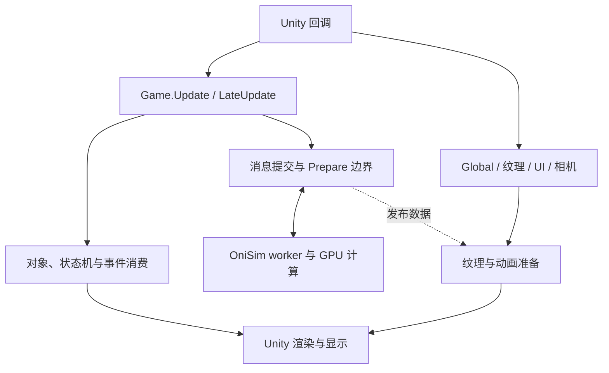

# CycleTrim 全游戏更新链路：优化方法与验证记录

日期：2026-11-09。

**本轮没有达到全链路性能目标。** 已决定撤回这轮未验收的原生候选和托管上传 gate，交付范围恢复 f408 既有生产优化，保留 22 阶段诊断、手动整链路 harness 与完整失败证据。四轮候选组合均未获得最终接受，其中上传 r2 的单独消融仍为 PASS；实验中的 idle 或重复上传收益不属于默认交付收益。撤回后的源码、构建和包验证单独记于 §7，不把实验正确性或单项快算当作最终版本性能接受。

**状态：四轮完整原生矩阵与四轮完整上传矩阵已全部记录。最新冻结代码 d374cff 的 1,292 个原生 sample 和 612 个上传 sample 输出/计数均通过，但原生五个控制回归超过 3%，上传大图 command 回归 3.658%，两组性能验收均为 FAIL。四轮原生均未通过，上传依次为 FAIL/PASS/FAIL/FAIL。r2 的 PASS 仅适用于当时的 938ada6 原生库，不能与新代码的其他通过项拼接验收。** 所有旧失败、全部场景与尾部结果均保留，保留决定另见 §7。本报告不把 host 调用频率当作游戏 FPS，也不从局部循环加速推断整帧收益。[29][30]

后续从现成 Release 机器码发现了原生发布交接中的大对象头复制，并在 **663f32a050069e8ff2fa0241d96da33248bc5938** 固定两份 GameData 的存放位置、只转移拥有者指针。新机器码和正确性确认该机制生效，但当轮完整 19+9 矩阵仍未达到接受条件。之后 d374cff 只缩小受严格前提保护的首次内容比较范围，新一轮完整矩阵仍未通过。源码省工、局部收益和正确性通过都不能改写整组 FAIL，也没有把失败归因为已证实的噪声。[23][24][25][26][27][28][29][30]

## 1. 要解决的问题

OniSim 接管原生仿真后，游戏仍需在主线程调度对象、消费仿真事件、准备表现数据并调用 Unity。把一部分网格计算交给 GPU，只改变其中几段工作。若主线程仍在重复复制纹理、串行等待任务或维护大量对象队列，完整更新间隔仍可能较长。本轮因此同时检查原生批次、数据发布、托管消费及独立 Unity 回调，不再用单个求解函数的计时代表游戏帧。[1][2]

本轮最初评估三项性能候选：用原生发布内容身份消除重复纹理上传；省去有当前快照证明的无液体区域遍历；修复 empty/zero 交替发布反复丢弃可复用结果的问题。之后追加 Box 交接与受限曝光历史比较两项修订。首轮无液体遍历主场景没有达到预定收益，提前撤回；后续各冻结组合也未达到完整门槛，因此本轮候选均不进入默认交付。另增加的完整 Game.Update 锚点分阶段诊断与手动 harness 保留，它们提供测量能力，本身不是 FPS 提升的证据。[3][4][5][12][13][21][25][28][29][30]

上传 gate 的首轮完整消融证明输出和上传次数符合预期，但小图持续变化控制回归 8.869%，超过 3% 限制，因此该轮不能验收。修复后的 r2 全部原门槛通过，小图持续变化中位数回归 2.003%；在新 Box native 上的 r3 则因中、大图 command 分别回归 4.419% 和 4.409% 而失败；d374cff 上的 r4 因大图 command 回归 3.658% 再次失败。各轮都在同一份当轮 native 上验证 gate 的增量作用；它们不能替代原生整版本对照，也不能跨库拼接结果。[14][22][27][30]

比较基线固定为 **OniMods `f40858eb626b8b4d18f0683ce3d0ed17b62fa1ea`，CycleTrim 0.4.11**。候选最终提交、二进制 SHA256、运行参数及原始样本随验证收据记录。原版静态源码固定为 `Kupie/ONI_Decomp@8d4ace10c2b6a84cee394653a91b990a5122e636`，声明 build 744825；本轮 62 个所用文件均与该提交的 Git blob SHA 对齐。这只确定审查的源码版本，不能替代编译用 reference DLL 或实际运行游戏的版本证明。[1][6]

## 2. 一次更新经过哪些边界

下图表示主要调用与数据交接关系，不规定独立 Unity 回调的先后顺序。



主要边界及仍存在的工作如下。依据是固定原版的方法体及当前接管入口，不是本轮实机热点排名。[1][2][3]

| 边界 | 实际工作 | 对 CPU/等待的含义 |
| --- | --- | --- |
| `Game.Update → SimEveryTick` | 管线、电路、格子变化检查；累积模拟时间并按子步驱动仿真 | 托管调度与对象访问仍在主线程 |
| `UnsafeSim200ms → NewGameFrame` | 组装活动世界区域并提交原生消息 | 提交本身及消息处理也有成本 |
| `StepTheSim → Sim.HandleMessage(PrepareGameData)` | 同步取得已完成的原生结果 | 墙钟时间可能同时含计算、等待和发布 |
| `StepTheSim` 的返回后工作 | 绑定 Grid/纹理指针，消费物质、固体、掉落物、伤害及回调事件 | 返回原生结果不等于完成游戏更新 |
| `StateMachineUpdater` 三个入口 | 驱动各频率的模拟与渲染分桶，执行建筑和对象逻辑 | OniSim 没有整体替换这些托管回调 |
| `AsyncPathProber.Manager.TickFrame` | 应用完成结果、维护年龄、排序、分配新探测任务 | 异步求解之外还有主线程队列与锁的成本 |
| `Global.LateUpdate` 与 KAnim | 更新动画控制器、脏数据、绘制提交 | CPU 准备时间与 GPU 真正绘制时间分开 |
| `PropertyTextures.LateUpdate` | 生成属性纹理、上传外部图、推进插值 | 独立 Unity 回调，不自动包含在 Game 两个回调内 |
| UI、相机、地形、声音与 App | 屏幕栈、相机/可见范围、地形块、声音参数、失焦/加载处理 | 存在 Game 以外的工作和有意等待 |

暂停也不意味着这些阶段都停止。`SimEveryTick` 在累积时间不足时仍能进入零时间步发布路径，渲染调度使用 unscaledDeltaTime，属性纹理、界面和相机也可能继续更新。因此运行与暂停的差值不能直接当作液体求解耗时。[1][2]

### 原生固定步也保留 CPU 阶段和同步

实验阶段固定审查的提交 `938ada6ecde8693513940d599e7aa5c18f3e5d22` 中，`PreparedStep.run` 并不是把整个固定步交给一个 GPU 调度。下表按当时生产调用顺序说明交接；它描述源码中的工作，不能作为真实存档的耗时排序，也不把该实验提交当作最终交付版本。这里的 read/write 同步是 CPU 快照复制，与等待 GPU 返回是两类不同成本。[20]

| 原生阶段 | GPU 路径与明确保留的 CPU 工作 | 后续依赖与同步 |
| --- | --- | --- |
| 固定步准备、气泡 | CPU preflight 校验数组、元素/疾病索引和区域；有 GPU 时提交气泡任务，否则 CPU `rise_bubbles` | `finish_move_bubbles` 完成结果应用后，执行全 CellSOA read/write 同步，并在 CPU 刷新活动气体通道 |
| 温度与相变 | GPU 路径仍由 CPU 准备材料/区域信息和上传状态；相变由 GPU 选择，CPU `apply_selected_transition` 应用结果及事件；无 GPU 时走 CPU 温度交换和相变 | 温度 dispatch 同一提交内读回到 `world.write.temperature`，随后仅复制温度快照；每区域相变后再复制该区域 CellSOA |
| 气体压力、排挤 | CPU 扫描并打包合格区域；生产路径小于 8192 个含边界格、状态/疾病等条件不满足时返回 CPU 压力路径。GPU 压力成功也不自动省去 CPU 排挤：只有 `gas_displacement_unneeded` 证明成立才跳过 | `gas_phase_with_pressure` 保留有方向顺序的 CPU 排挤和 flow/event 写入；可能改格子时复制流体字段的区域快照 |
| 多组分气/液扩散 | CPU 选择通道、资格与遮罩、打包数据并应用回读投影；气体小区域仍可走 CPU `cpu_step`。合格液体扩散先提交，再运行气体 transport，之后取得液体结果；未由 GPU 遮罩接管的部分仍由 `gas::diffuse_region` 处理 | GPU 返回结果仍需 CPU 写回物质、温度和事件；完成这些更新后复制当前区域，而非假定所有状态一直驻留 GPU |
| 液体压力与流动 | **生产 `gpu_liquid_flow` 固定为 `false`**；`PressureScratch.run`、逐格 `fluid::update_liquid`、有序液体排挤与 flow 更新继续在 CPU。上行的 GPU 多组分液体扩散不等于接管这段液体流动 | 若可能修改格子，继续复制该区域的流体快照；本轮已撤回的无液体遍历候选没有改变此最终路径 |
| 疾病、辐射、组件与后处理 | GPU 疾病路径仍有 CPU 打包/回填，小疾病区域回退 CPU；辐射在适用时提交 GPU，否则 CPU。物质消费/发射、疾病组件、热块、建筑、接触热与逐格 `postprocess::cell` 继续在 CPU | pending 辐射/衰减可与部分组件工作交叠，但在其后续消费者前完成结果；组件事件仍按原顺序合并，不存在“整帧只提交、不等待”的承诺 |
| 批次发布 | 固定步外，`Engine.run_batch` 继续发布组件事件、对旧 Grid 做差分、生成或复用五图及多组分结果，最后由 `State.publish_ready` 复制稳定 public Grid | 候选曾尝试扩大派生复用与跳过重复托管上传；这轮改动已决定撤回，命令、事件、累积流量、生命周期及公开指针的发布义务不变 |

因此后续整链定位应同时检查 CPU 本体、区域资格扫描/打包、GPU 等待/回读、快照复制和托管消费。现有采样中的 `simulation_wall`、`temperature+sync` 等字段包含其相应等待或复制，不能直接标成 GPU kernel 时间；也不能仅因源码存在一个 CPU 循环就宣布它是实际最高热点。[5][20]

### 仍存在的 Grid 数组复制

`State.publish_ready → Grid.copy_from` 继续把完成的 GameData 复制到稳定的 public Grid。按当前字段类型逐项核对，显式数组复制载荷为每格 **48 字节**：[17]

| 数组组 | 每格字节数 |
| --- | ---: |
| 元素、温度、质量、properties/insulation/strength 与 cell_padding | 16 |
| disease_idx、disease_count 与 disease_reserved | 12 |
| 背墙元素、质量、温度与 backwall_padding | 12 |
| radiation | 4 |
| accumulated_flow | 4 |
| 合计 | **48** |

descriptor 另复制帧计数 4 字节、29 组事件 count/pointer 共 348 字节、5 个纹理指针共 40 字节，合计 **392 字节**；12 个格数组指针和 accumulated_flow 指针保留稳定 view 自己的地址。736×304 共 223,744 格，因而一次发布的显式数组载荷为 **10,739,712 字节**，加上述 descriptor 切片为 **10,740,104 字节**，另有少量标量赋值。这个数值来自源码复制范围，不是测得的内存总流量、带宽或每个渲染帧的工作量；实际缓存、读写流量和发布频率需要单独观测。[17]

该实现明确维护这组稳定数组地址，原生链回归也逐批核对；worker 同时使用独立的 `old.grid` 做事件差分。直接交换 GameData 与 public Grid 的所有权，可能把用于差分的旧快照换成更早的数据；让外部指针直接随双缓冲切换，则改变稳定 view 的地址约定。固定原版 `Game.StepTheSim` 每次 Prepare 确实会重新绑定 Grid 指针，所以未来可以研究结构性改造，但需要审查所有持有地址的调用方并重新证明双缓冲、事件和借用生命周期。本轮实验没有消除这段复制，整条链路仍有数据搬运成本。[1][17]

### 哪些 CPU 工作不能仅靠启用 GPU 消失

规则相同、数据连续的大量格子计算适合并行执行；涉及 Unity 对象、状态机回调、池对象所有权和顺序化事件消费的代码，则需要先改变表示和交接协议才能迁移。仅增加 GPU kernel 不会自动把这些对象变成 GPU 数据，也不会消除结果读回、主线程等待与纹理上传。这是本轮按交接边界定位问题的原因，不是断言这些系统永远不能重写。[1][2][3]

当前寻路补丁调整配额并减少部分重复生物探测，仍保留主线程全量排序和结果应用；现有 TextureLerper 优化只省去随后被覆盖的可视范围计算，保留插值相机和 RenderTexture；NavGrid 的全表入口仍按脏格更新，不能称为每帧重建整张地图。报告将这些边界与候选的实际变化分开。[2][7]

## 3. 性能候选与后续修订

本节说明各冻结实验做了什么、为何考虑、如何验证以及为何最终未接受。所述 revision、跨模式复用、Box 与曝光历史 helper 均是本轮实验内容，不代表撤回后的默认生产行为；代码引用与收据固定到各实验提交，最终范围见 §7。

### 3.1 从发布结果到 Texture2D 的重复上传

固定原版 `UpdateProperty` 对五张外部图分别提交每格 8、4、4、4、1 字节，合计 **21 × 格数** 字节；它们都属于每帧更新项。736×304 格的一次原始载荷为 4,698,624 字节，约 4.48 MiB。这是源码计算的载荷量，不是测得的 GPU 带宽、复制总量或耗时。[2]

候选由原生端提供 session generation 与 derived revision，区分“新生成的图”与“交替缓冲区里的相同内容”。托管端只有在同一 Texture2D 已成功完成对应图片上传，且内容身份、尺寸、长度、图片索引、Unity updateCount 和缓存实例都匹配时，才跳过这对 LoadRawTextureData/Apply。内容变化、纹理重建、版本未知、元数据不可用或上传异常会保留正常上传。LateUpdate、模拟消息与插值仍执行。[3]

独立审查补强了重入生命周期：即使重新设置的是同一个 reader 委托，缓存表也已改变，所以旧 Pending 不能写入新表。该冻结实现以缓存表实例作为身份，并在查询、跳过和提交时核对。host 回归演练了同 reader 重设、Load/Apply 内嵌套 LateUpdate、不同图片共享 Texture2D、异常与恢复。[3]

该机制的正确性通过不等于性能通过。首轮 612 个 sample 的字节、SHA 和调用计数均满足要求，96×96 持续变化控制却未达到既定性能门槛。变更路径修订为复用首次缓存查询结果后，辅助诊断未测出稳定墙钟节省；938ada6 库上的独立完整 r2 达到原九场景门槛，后续 Box 库上的 r3 出现两个 command 控制失败。r2 的通过只属于其具体库、host 和固定消融协议，不能据 before/after 诊断差值声称单次缓存查询节省了某个固定时长，也不能替代 r3。[14][15][16][22][27]

随后独立审查还发现候选中的一个**实际可达的内容身份正确性阻断**：sunlight pass 只写当前 world offsets 覆盖的像素，未覆盖部分保留各自 GameData 的历史。started 世界仍允许 DefineWorldOffsets/Free；这些调用不会清零或重建两套表现缓冲。因此 A、B 可以在范围缩小后各保留不同的 sunlight 字节，即使重新计算两次也不保证五图相同。候选早期逻辑把“世界未变、两缓冲已预热”直接当成共享 revision 的证明，可能让 managed 错误跳过需要交替上传的不同图片。这是实验性内容身份逻辑的问题，不据此声称 f408 存在相同的上传错误。[18]

938ada6 和 663f32a 中的实际修复在同一未变 epoch 的首次复用时，精确比较两缓冲的五图字节：相同才共享旧缓冲的内容身份，不同则保留各自生成时的 revision。`Option<bool>` 同时缓存相同和不同结果，因此每个未变 epoch 至多比较一次。flow 按原始字节比较，保留正负零和 NaN payload 的区别；其他四图按整数数组精确比较。重新生成、首次 read 同步或其他失效都会清空证明，计数溢出后的零身份优先于复用旧的非零身份。比较不改像素、事件或原有局部写入行为。后续缩小比较范围的实验另见 §3.5，不覆盖这些版本的原始验证。[18][19][28]

负控保留旧的共享 revision 分支并运行新回归，实际出现一次预期失败：缩小 offsets 后首次复用把缓冲自身的 revision 3 改成了 4。修复后的定向测试 **9/9 通过**，其中四项内容身份测试覆盖缩小/清空 offsets 后交替内容、恢复全覆盖后的重新共享、真实 State/worker 交接、正负零/NaN 字节比较和身份耗尽。它们提供原生端证据；导出库到 managed 的 r2 九场景完整矩阵另列于 §5.2，不将该静态矩阵当作动态拓扑用例的替代。原始 73 批 oracle 与首轮固定矩阵未覆盖动态 offsets，不能追溯宣称它们已证明此边界。[19][22]

### 3.2 已拒绝：省去确定无液体区域的重复遍历

首轮候选复用现有液体压力准备阶段的当前快照，记录是否存在 primary liquid。只有主区域和额外位移行都没有这种液体时，才省去两个后续显式液体遍历；零质量、不可进入隐式求解器及混合格中的液体仍按原行为处理。它不改变压力方程、迭代上限、区域顺序、时间步或后端选择。[4]

这里验证的是完整 worker 批次是否变快，而非这个判断自身是否便宜。既有求解器本来就会在没有有效面时停止迭代，本轮不把这项已有行为算作新收益。首轮大纯气体完整批次中位数变化为 +0.428%，未达到至少 5% 改善，因此按原门槛拒绝该候选，保留失败结果和补丁，并从最终代码移除这一优化。[4][8][13]

### 3.3 实验候选：保存 empty/zero 交替发布的复用证明

真实原生库接入托管回归时发现，worker 会在没有提交帧的 empty 批次与提交零时间帧的 zero 批次之间交替。原先按这两种模式切换清空 derived warmup，会反复重新生成 Grid、五图和多组分发布，即使世界内容没有改变。这里的“真实原生”指实际 OniSim worker 与导出连接，并非已启动 ONI 游戏。[8][12]

候选记录 `idle_read_synchronized`：当前 read/write 是否已在成功结束的整批零时间帧中同步。第一次 idle 同步可能改变依赖旧 read 的表现图，因此仍清空复用计数、重新填满两个交替缓冲；之后 empty 不会令已同步的 read 再次过期，可以保留复用证明。非 idle 批次和 `State.with_world_mut` 先使同步与复用证明失效。若整批命令帧的 elapsed 都为零，命令后同步已完成、flow 已清零且当前输出已重新生成，则在成功结束时保存同步事实，并将这个输出计为一个已更新缓冲；下一次 unchanged 批次仍刷新另一缓冲。有实际推进或混合 elapsed 的批次不使用这条证明。事件、累积流量的十五次发布重置、帧计数、可见性交换及后续提交继续执行。[12][19]

独立 direct Engine 对照按 73 批固定脚本比较复用与强制重算。它先制造可见的 read/write 差异，断言首次同步确实改变图片，再覆盖 debug、属性、材料命令、推进、两种 zero/advance 混合顺序和立即修改。两侧使用新进程，使 process-global 流量重置周期对齐；逐批比较 Grid、事件、五图、多组分、世界状态和残余时间。该对照验证计算复用的字节语义；worker/FFI 交接另由生产链测试验证，不能由 direct Engine 对照代替。[12]

后续回归已扩展为 **139 批，保留原 73 批完整前缀**，并通过复用与强制重算的独立进程逐字节对照。新增段覆盖零时间命令与 empty/zero 交替、多命令和推进混合顺序、区域重新划分、可见性交接及累积流量重置；动态 world offsets 另由上述专门身份测试覆盖。冻结生产源码的 19-case 正确性矩阵也已完成：38 个进程、每侧 456 个快照点全部相等。随后完整 19+9 性能矩阵保留首次复用字节比较的生产成本和原门槛；原生组出现三个控制失败，不能以这些正确性通过或单项 idle 收益代替性能验收。[12][19][21][22]

### 3.4 Box 候选：减少 worker 交接对象头复制，完整复验未通过

完整链路包含 `worker → ready mailbox → ReadyLease → returned mailbox → worker` 的所有权转移。虽然各图像和 Grid 数组本身位于堆上，原实现按值搬动的 GameData 头仍包含各缓冲的拥有者。现成 Release executable 的实际机器码表明，938ada6 的一轮成功交接至少有 **10 次 memcpy，长度参数合计 12,464 B，其中 7 次发生在 mailbox mutex 内**；`wait_ready` 在检查 Option 是否为 None 之前还会复制 1,240 B，因此尚未 ready 的额外等待迭代也有这项工作。[23]

这不是新版本独有的成本。相同路径的 f408 基线已经复制 **12,384 B**；新增 revision 将 GameData 从 1,240 B 扩到 1,248 B，十处已统计复制仅多 **80 B**。该清单是静态机器码中 memcpy 长度的下界，不是实测内存带宽，不含调用方其他 moves、可见性数组、稳定 public Grid、启动或展开路径，也没有把读写各算一次。不能用 12,464 B 当作此次新引入的开销，更不能据此解释上轮三个控制回归。[23]

新候选只在 `Worker.spawn` 为两份非零大小的 GameData 各分配一个 `Box<D>`，之后 ready、returned、ReadyLease、output/old 和 fault_retained 转移 Box 的拥有权。runner 与 lease 的外部 Rust 接口继续提供 `&mut D` / `&D`，不增加逐批 payload Box 分配；原有 handoff 闭包分配仍存在。独立静态审查确认补丁没有改变锁与 notify 顺序，handoff 仍在锁外写旧缓冲后轮换，runner 失败仍保留上一发布到 fault_retained，lease/stop/drop 分支保持原结构。两份数组与 496 B 外部 descriptor 不变。它减少的是对象头交接工作，**不会消除 §2 的 48 B/格 + 392 B public Grid 复制**。新增两次启动分配和后续间接访问是实际取舍；完整矩阵中的控制失败仍使该冻结组合未获性能接受。[23][24][25][26][27]

新增测试已在旧 by-value 生产代码上运行一次机制负控：真实 worker runner 到 ReadyLease 的 payload 头地址发生变化，指定回归按预期失败。这个负控证明测试能区分两种搬运机制，**不表示旧实现违反已有 API**——旧契约要求稳定的是公开数组和发布生命周期，并未要求私有 GameData 头地址不移动。新 Box 版本 worker **9/9** 与 presentation **9/9** 已通过，含八次 old-buffer handoff、持 lease 退出、第二批 runner panic 后保留上一发布、每个 payload 恰好析构一次、139 批 oracle 与四项内容身份回归；19-case 正确性另取得每侧 456 个相等快照点。[24][25]

改后机器码进一步确认：`wait_ready` 只取指针、置空并检查，`release_inner` 与真正的 worker entry 转移指针/闭包字段，三处完整方法体已没有旧的大头 memcpy。这里检查的是 **3,288 B 的真实 worker entry**，而不是误将其 **52 B wrapper** 当成全部循环。spawn 初始化仍有三个 1,248 B 对象复制，物理阶段与稳定 Grid 的复制也仍存在。该证据证明省去了特定搬运机制；表 1C/2D 仍未达到全部性能门槛，所以不能把它直接等同于整链优化成功。[25][26][27]

### Box 候选的完整复验约束

Box 改动没有复用上一轮已通过的场景拼接验收。原生使用同一 f408 基线、新鲜两侧样本、原 19 个场景和每侧 34 个 sample；大图 alternating_idle 要求改善至少 10%，其余 18 项回归至多 3%。上传组在同一份新 native 上完整比较 original 与 gate，九场景、每侧 34 个 sample 和全部原门槛不变。表 1C、2D 独立保留完整失败结果，表 1A/1B 与 2A/2B 的原始样本、失败和尾部数字均未覆盖。[8][10][23][26][27]

### 3.5 曝光历史比较候选：受限省工证明与失败复验

新候选保留原复用入口，只将其中的五图比较缩小为完整 `exposed` 字节比较。这个推导有明确前提：两份图像属于同一固定形状生命周期，已分别从同一稳定 world/read、不可变元素表和固定浮点控制成功生成，且借用者遵守原有只读合同。flow 每次完整写入；三张液体相关图的已处理行全部赋值，非液体也写零，其最后一行保持固定生命周期的构造零。实际处理液体行时梯度缓存先清空，height≤1 则不读取它；sunlight 仍可能保留 offsets 外的历史。因此在这个受限入口，两份 exposed 相同可以推出完整五图相同，不能用于任意缓冲判等。[28]

`Option<bool>` 的每 epoch 至多一次比较、所有失效、不同曝光历史保留各自 revision，以及耗尽后永久零身份均未改。完整五图原始字节 comparator 保留为独立测试 oracle，既有正负零、NaN payload、动态 offsets 和 139 批对照未删除。新增四组测试覆盖合法不同旧缓存/图像历史、部分 offsets 与前提外反例、同面积重新分配和启动后拒绝变形，以及 16 组固定 rounding/DAZ/FTZ、不同 sticky flags 和安全未屏蔽 invalid 路径。独立静态审查未发现阻断；随后统一执行的 worker 9/9、history 4/4 与既有 presentation 9/9 通过，19 场景、38 进程的已记录快照全部相等。默认并发全集为 **130 通过、11 失败、9 ignored**，失败集合与前轮相同；不能称全集通过。源码固定于 d374cff，其完整性能结果另列表 1D/2E，两组均 FAIL。[28][29][30]

对于完整相等的两份图像，比较对象的源级覆盖由两侧合计 **42 B/格降为 2 B/格**；736×304 对应 **9,397,248→447,488 B**。这是每个未变 epoch 首次比较的逻辑对象量，不是实测内存流量、每帧成本或整链提速。上轮失败的 native command 与 advancing regions 不进入此分支，所以该候选不能解释或豁免表 1C 的两个回退。新一轮已用全新两侧样本完成原 19+9 场景、每侧 34 sample 与全部原门槛；五个原生控制和一个上传控制失败，前三轮结果也继续保留。不能把各轮中不同控制的通过项拼成一个通过版本。[8][26][27][28][29][30]

## 4. 22 个阶段的计时含义

诊断通过 `--cycletrim-perf-probe` 统一开启托管阶段与原生采样；显式原生诊断环境设置得到保留。日志以 `[CycleTrim][FrameChain]` 输出 schema 1 JSON。诊断不开启时不安装这些专用计时 hook。[5]

完整区间由连续 Unity 帧中的两个 Game.Update 入口界定。`firstFrame` 包含起点，`endFrame` 为下一边界；重复同帧入口不增加帧样本，跳帧/时钟不连续会重新建立窗口。它衡量 Game.Update cadence，不证明某台相机已渲染或某帧已显示。[5]

| 阶段名 | 主要含义 | 解释边界 |
| --- | --- | --- |
| `Game.Update` | Game 主更新 | inclusive 包含下属阶段 |
| `Game.LateUpdate` | 管线、渲染调度、状态与声音 | 不是整帧总时间 |
| `Game.SimEveryTick` | 模拟时间与子步调度 | 不等于所有原生计算 |
| `Game.StepTheSim` | Prepare 调用及返回后的托管消费 | 不是纯等待 |
| `Global.Update` | 全局输入、动画事件等 | 独立 Unity 回调 |
| `Global.LateUpdate` | 流式纹理请求及动画控制器更新 | 独立 Unity 回调 |
| `Game.UnsafeSim200ms` | 区域消息、原生步、世界及导航更新 | 包含直接 NewGameFrame 调用 |
| `Sim.PrepareGameData` | 指定 HandleMessage 重载与消息的同步边界 | 计算/等待/发布的墙钟总和，不是 GPU 时间 |
| `JobManager.Run` | 主线程参与任务并等待 worker | 不是纯屏障等待或所有线程 CPU 总和 |
| `StateMachineUpdater.AdvanceOneSimSubTick` | 托管模拟分桶 | 仍有建筑、对象及状态逻辑 |
| `StateMachineUpdater.Render` | 托管周期渲染分桶 | 包含注册对象回调 |
| `StateMachineUpdater.RenderEveryTick` | 每帧渲染分桶 | 包含 BrainScheduler 等注册工作 |
| `PropertyTextures.LateUpdate` | 纹理生成/上传与插值设置 | 不包含全部后续相机/GPU 执行 |
| `KAnimBatchManager.UpdateDirty` | 动画脏数据准备与提交 | CPU 方法墙钟 |
| `KAnimBatchManager.Render` | 动画绘制提交 | 不代表 GPU 绘制完成时间 |
| `Pathfinding.UpdateNavGrids` | 脏导航图更新 | 不把入口视为全图重建 |
| `AsyncPathProber.Manager.TickFrame` | 寻路结果、队列、排序和锁 | 不包含全部 worker 求解时间 |
| `KScreenManager.Update` | 屏幕栈更新 | 独立 Unity 回调 |
| `CameraController.Update` | 相机、可见范围和声音裁剪 | 不代表实际 GPU 相机渲染 |
| `GroundRenderer.Render` | 地形块重建及提交 | CPU 方法墙钟 |
| `KFMOD.RenderEveryTick` | 声音参数更新 | 通常位于 Game.LateUpdate 内 |
| `App.LateUpdate` | 加载、清理及失焦行为 | 可能含有意休眠或加载 GC |

inclusive 包含被测子调用；self 扣除这些子调用。完整覆盖时间是最外层已测区间的 union，等于所有阶段 self 之和，不能把 inclusive 再相加。同 phase 递归的 calls 和 inclusive 按外层调用合并；因此 calls 不是所有递归方法进入次数。独立回调按发生在锚点间的实际时间计入，不假设 Unity 固定排序。[5]

未归因时间为区间总时长减去已测 union，可能含未挂钩代码、引擎工作、线程等待、渲染/显示等待和诊断输出开销。`resolved` 表示找到方法签名；分析器的 complete 表示所声明字段/解析状态和账目完整，不意味着覆盖了游戏全部工作或所有 hook 已在游戏实际执行。GC 次数也不提供 GC 停顿时长。[5]

独立复核修正了一个边界问题：非 Game 的父 scope 尚未关闭、但子 scope 已关闭时，如果进入下一锚点，不能只保留子 self 而漏掉父 union。当前实现会丢弃该不完整区间并换代；已有 capture 也拒绝异线程 Game.Update 污染。最终 host 场景实际调用了 22 个阶段，各 2048 次，并验证 self/covered/total 恒等式；这仍是合成调用验证。[5][9]

## 5. 实验方法与结果

两组实验都先固定场景、对照、计时边界与验收阈值，再采样。构建、其他测试和其他代理计时不与正式测量并发。输出等价是先决条件，任何状态差异都会拒绝候选；超时、缺样和环境干扰不能写成通过。下列表格必须逐项填齐，失败或拒绝的场景也保留。[8][10]

八份正式矩阵的结论如下。每份都独立完整采样；同一行中的“通过/失败”只描述该矩阵，不能跨行拼出一个已经通过的新版本。[13][14][21][22][26][27][29][30]

| 矩阵 | 测量源码/原生库版本 | 样本数 | 既定性能结论 | 未通过条件 |
| --- | --- | ---: | --- | --- |
| 原生表 1A | eb318f7，首轮组合 | 1,292 | FAIL | 大图 pure +0.428%，未达至少 5% 改善 |
| 原生表 1B | 938ada6，移除液体遍历候选 | 1,292 | FAIL | 两个 mixed 与小图 command 超过 3% 回归 |
| 原生表 1C | 663f32a，加入 Box 交接 | 1,292 | FAIL | 小图 regions +6.658%、command +11.436% |
| 原生表 1D | d374cff，缩小首次历史比较 | 1,292 | FAIL | 小图 liquid、三尺寸 mixed、小图 command 超过 3% |
| 上传表 2A | 0942cb9，同库 gate 消融 | 612 | FAIL | 小图 command +8.869% |
| 上传表 2B | 938ada6，同库 gate 消融 | 612 | PASS | 无；保留两项小图 P95 恶化 |
| 上传表 2D | 663f32a，同库 gate 消融 | 612 | FAIL | 中图 command +4.419%、大图 command +4.409% |
| 上传表 2E | d374cff，同库 gate 消融 | 612 | FAIL | 大图 command +3.658%；另保留小图 zero +23.524% 的规模控制回退 |

### 5.1 完整原生批次

比较 0.4.11 基线与冻结候选，使用相同 harness、Release Rust 1.99.1、locked offline 依赖和一个原生 cell worker。每个 sample 新建进程，预热两批，计时四批的平均值。每场景每侧 34 个独立 sample，17 个交替 ABBA/BAAB block。计时边界为 `State.submit_frame → ReadyLease.release_with → worker/Engine → wait_ready → State.finish_prepare`，包括命令执行、可见性复制、结果生成与交接、事件完成及稳定 public Grid 复制。fixture 初始化、两份 GameData 的启动构建、NewFrame/regions/visibility 准备、handle 获取、输出观察和关闭在墙钟区间外。这是原生提交至发布链路，不包含完整托管 P/Invoke、Game 调度或 Unity 帧。[4][8]

首轮原先固定的 16 个 case 保留不变。首次正式性能采样前，在 **2026-11-09 09:54:31 UTC** 的计划附录中增加三个 `alternating_idle` case。其 bootstrap 为 empty，之后连续执行 zero、empty、zero、empty；预热与测量边界不重启交替序列，最终仍有推进一步的观察。首轮两组接受条件分别报告：[8]

| 接受组 | 完整批次主门槛 | 控制门槛 |
| --- | --- | --- |
| 无液体遍历候选 | 原 736×304 pure 中位数改善 ≥5% | 原其余 15 个 case 回归均 ≤3% |
| 交替 idle 复用候选 | 新 736×304 alternating_idle 中位数改善 ≥10% | 两个较小 alternating_idle 及原 15 个控制 case 回归均 ≤3% |
| 组合候选 | 两个主门槛都通过 | 全部 19 个 case 的对应门槛都通过 |

这两组门槛是在同一个组合候选上判定，不能解释为两个独立消融；其中还包含发布 revision 等同时交付的变更。若删除任何候选，应重新冻结并验证实际保留的代码组合。新增 idle 改善不能替代原 pure 主门槛，也不能抵销任何控制场景失败。[8]

记录所有原始值、中位数、sample 均值的 P95、离散范围、进程 CPU ticks、major faults 与峰值 RSS。P95 使用 nearest-rank：34 个 sample 排序后取第 33 个，不是单批次或游戏帧的 P95。CPU ticks 在整个 `advance` 前后采集，比墙钟区间多包含输入准备和地址检查，且受 `SC_CLK_TCK` 粒度限制；不能与 wall 时间直接当作同边界的 CPU/等待分解。RSS 包含计时外快照分配。计数窗口内出现 major fault 时，整个配对 block 无效，保留记录后按固定规则重跑；超时也保留已捕获的子进程日志。只有完整批次 wall median 决定性能门槛。所有结果仍限于本机合成原生世界，不能外推真实存档或 GPU 后端。[8]

正确性比较覆盖连续发布的 Grid、五张表现图、29 个 ABI 事件跨度及多组分数据；同时比较后续物理状态、混合物、流量、RNG/扫描状态与残余时间，最后再推进一批确认未来状态未分叉。指针地址及新增 revision 不要求跨版本相等；浮点值按位比较。正确性轨迹跨过第 15 次 accumulated-flow 重置。[8]

#### 首轮组合：完整结果，整体未通过

首轮采样区间为 **2026-11-09 10:03:19–10:12:29 UTC**；组合代码为 `eb318f72aa7dc516a197f0103e37e1462d1a103d`。19 个 case 各侧 34 个 sample，共 **1,292 个有效 sample、0 个无效 sample、0 次重试**，所有记录的完整发布/世界快照一致。下面逐项给出全部结果，变化按 `候选/基线−1` 计算，负值表示耗时下降。判定来自原始未四舍五入的中位数。[13]

表 1A：**被拒绝组合**的首轮结果。每个耗时单元为“中位数 / sample P95”，单位均为 µs/批次；P95 是四批平均值的 nearest-rank P95。

| 尺寸 | 场景/提交时间 | 首轮基线中位数 / P95 ↓ | 首轮组合中位数 / P95 ↓ | 变化 / 门槛 | 单项判定 |
| --- | --- | ---: | ---: | --- | --- |
| 96×96 | pure，0.2 s | 1,721.305 / 3,110.242 | 1,711.051 / 1,957.798 | −0.596% / ≤+3% | 该项通过 |
| 96×96 | liquid，0.2 s | 2,928.915 / 4,617.795 | 2,874.456 / 3,949.341 | −1.859% / ≤+3% | 该项通过 |
| 96×96 | mixed，0.2 s | 3,433.411 / 4,985.931 | 3,416.956 / 4,037.569 | −0.479% / ≤+3% | 该项通过 |
| 96×96 | thermal，0.2 s | 746.384 / 1,233.442 | 758.978 / 1,343.455 | +1.687% / ≤+3% | 该项通过 |
| 96×96 | regions，0.2 s | 1,873.429 / 2,987.014 | 1,741.842 / 2,374.169 | −7.024% / ≤+3% | 该项通过 |
| 256×384 | pure，0.2 s | 18,818.759 / 29,774.663 | 18,718.699 / 28,330.963 | −0.532% / ≤+3% | 该项通过 |
| 256×384 | liquid，0.2 s | 21,527.203 / 26,984.848 | 21,248.537 / 42,573.230 | −1.294% / ≤+3% | 该项通过 |
| 256×384 | mixed，0.2 s | 24,329.327 / 37,030.938 | 24,543.319 / 46,908.791 | +0.880% / ≤+3% | 该项通过 |
| 256×384 | thermal，0.2 s | 8,153.244 / 13,583.457 | 7,686.682 / 9,638.733 | −5.722% / ≤+3% | 该项通过 |
| 256×384 | regions，0.2 s | 19,981.050 / 30,219.195 | 20,214.412 / 34,098.972 | +1.168% / ≤+3% | 该项通过 |
| 736×304 | pure，0.2 s | 44,475.642 / 58,657.050 | 44,665.823 / 57,514.705 | +0.428% / ≤−5% | **未通过** |
| 736×304 | mixed，0.2 s | 57,046.196 / 88,782.044 | 55,272.391 / 104,676.316 | −3.109% / ≤+3% | 该项通过 |
| 96×96 | regions，1.0 s/五子步 | 7,663.838 / 11,761.906 | 7,460.893 / 11,760.873 | −2.648% / ≤+3% | 该项通过 |
| 96×96 | empty，不提交 NewFrame | 59.455 / 96.417 | 50.769 / 171.725 | −14.610% / ≤+3% | 该项通过 |
| 96×96 | zero，0 s | 75.033 / 520.895 | 67.629 / 98.657 | −9.868% / ≤+3% | 该项通过 |
| 96×96 | command，0 s 加材料命令 | 294.257 / 1,600.836 | 286.980 / 397.571 | −2.473% / ≤+3% | 该项通过 |
| 96×96 | alternating_idle，zero/empty 交替 | 285.989 / 1,194.185 | 67.796 / 2,053.430 | −76.294% / ≤+3% | 该项通过 |
| 256×384 | alternating_idle，zero/empty 交替 | 2,991.992 / 4,281.182 | 598.778 / 5,134.033 | −79.987% / ≤+3% | 该项通过 |
| 736×304 | alternating_idle，zero/empty 交替 | 9,043.805 / 13,361.912 | 1,792.834 / 5,868.549 | −80.176% / ≤−10% | 该项通过 |

736×304 pure 从 **44,475.642** 增至 **44,665.823 µs/批次（+0.428%）**，未达到事前要求的至少 5% 改善。因此无液体遍历候选被拒绝，决定从最终代码移除；该首轮组合的 `performance_accepted=false`。没有用其他场景的改善抵销这项失败。[13]

交替 idle 三个尺寸的中位数分别下降 **76.294%、79.987%、80.176%**，且原 15 个控制均满足 ≤3% 回归限制，所以该组合上的 `alternating_idle_accepted=true`。这支持继续保留 idle 修复并验证删除液体候选后的代码，**不等于首轮组合整体验收通过，也不等于最终版本已完成验收**。[13]

尾部结果也全部保留。两个较小 idle case 的 P95 分别从 **1,194.185→2,053.430 µs**、**4,281.182→5,134.033 µs** 上升；大图从 **13,361.912→5,868.549 µs** 下降。首轮只支持所定义的中位数门槛，不能概括为所有场景尾延迟都改善；本轮不据此补样、删样或更改原门槛。各侧 min/max、标准差、全部原始时长和进程诊断记录在原始收据中。[13]

#### 保留代码完整复验：整体未通过

最终复验协议于 **2026-11-09 10:16:50 UTC** 固定在计划附录中，早于该保留代码的性能测量。它移除无液体遍历候选，保留 idle 同步证明、发布身份与相关最终代码。验证对象已经改变，因此须重新冻结代码并对同一 0.4.11 基线执行完整 19-case 对照。**两侧全部重新采样，表 1B 不复用表 1A 的基线数字。** 最终问题仅为 idle 修复是否满足大图 ≥10% 改善，同时其余 **18 个 case** 都不超过 3% 回归；原 pure 大图作为额外的 3% 控制，不再主张液体扫描的 5% 收益。首次组合的失败记录和删除决定保持不变。[8][13]

runner 用显式 `retained_idle` scope 区分此次验证，并先要求两份撤回生产文件与 f40858e 基线 hash 一致；独立复核再次确认这两个文件的 hash 相等。本轮冻结源为 `938ada6ecde8693513940d599e7aa5c18f3e5d22`，采样区间 **2026-11-09 11:11:36–11:21:02 UTC**，完整取得 **1,292 个有效 sample、0 无效 sample、0 重试**。独立复核逐项读取全部原始进程日志，校验八个快照、四批计时、ABBA/BAAB 位置与汇总数字；所有发布/世界快照相等，三个控制场景未达到性能门槛。[8][21]

表 1B：移除被拒绝液体候选后的完整 19-case 复验，**整体 FAIL**；单位 µs/批次。每个耗时单元为“中位数 / sample P95”，与表 1A 使用各轮自己的独立样本。

| 尺寸 | 场景/提交时间 | 第二轮新基线中位数 / P95 ↓ | 第二轮候选中位数 / P95 ↓ | 变化/门槛 | 结果 |
| --- | --- | ---: | ---: | --- | --- |
| 96×96 | pure，0.2 s | 1,816.844 / 3,640.687 | 1,758.237 / 2,724.350 | −3.226% / ≤+3% | 该项通过 |
| 96×96 | liquid，0.2 s | 3,017.886 / 6,028.613 | 2,937.505 / 5,362.439 | −2.663% / ≤+3% | 该项通过 |
| 96×96 | mixed，0.2 s | 3,457.336 / 7,075.361 | 3,706.990 / 8,351.014 | +7.221% / ≤+3% | **未通过** |
| 96×96 | thermal，0.2 s | 813.306 / 1,773.024 | 771.878 / 1,579.905 | −5.094% / ≤+3% | 该项通过 |
| 96×96 | regions，0.2 s | 1,922.202 / 4,252.819 | 1,766.552 / 3,075.034 | −8.097% / ≤+3% | 该项通过 |
| 256×384 | pure，0.2 s | 19,618.946 / 39,717.647 | 19,197.940 / 41,611.876 | −2.146% / ≤+3% | 该项通过 |
| 256×384 | liquid，0.2 s | 21,318.104 / 36,710.308 | 21,212.915 / 43,231.940 | −0.493% / ≤+3% | 该项通过 |
| 256×384 | mixed，0.2 s | 25,213.262 / 44,678.041 | 23,862.950 / 36,386.804 | −5.356% / ≤+3% | 该项通过 |
| 256×384 | thermal，0.2 s | 8,200.695 / 15,242.865 | 8,301.518 / 16,452.126 | +1.229% / ≤+3% | 该项通过 |
| 256×384 | regions，0.2 s | 19,757.309 / 23,841.714 | 20,020.697 / 27,319.967 | +1.333% / ≤+3% | 该项通过 |
| 736×304 | pure，0.2 s | 46,197.025 / 53,551.173 | 45,955.973 / 89,747.793 | −0.522% / ≤+3% | 该项通过 |
| 736×304 | mixed，0.2 s | 54,092.738 / 91,071.296 | 56,039.360 / 108,569.171 | +3.599% / ≤+3% | **未通过** |
| 96×96 | regions，1.0 s/五子步 | 7,593.777 / 12,797.379 | 7,543.255 / 12,454.564 | −0.665% / ≤+3% | 该项通过 |
| 96×96 | empty，不提交 NewFrame | 56.730 / 490.603 | 57.499 / 1,169.344 | +1.356% / ≤+3% | 该项通过 |
| 96×96 | zero，0 s | 70.915 / 173.448 | 71.848 / 158.161 | +1.316% / ≤+3% | 该项通过 |
| 96×96 | command，0 s 加材料命令 | 280.055 / 492.524 | 294.750 / 1,322.625 | +5.247% / ≤+3% | **未通过** |
| 96×96 | alternating_idle，zero/empty 交替 | 258.467 / 642.306 | 72.606 / 183.082 | −71.909% / ≤+3% | 该项通过 |
| 256×384 | alternating_idle，zero/empty 交替 | 3,137.731 / 8,677.064 | 639.587 / 3,335.173 | −79.616% / ≤+3% | 该项通过 |
| 736×304 | alternating_idle，zero/empty 交替 | 8,958.915 / 16,200.627 | 2,058.834 / 4,904.198 | −77.019% / ≤−10% | 该项通过 |

大图 alternating_idle 中位数从 **8,958.915 降至 2,058.834 µs（−77.019%）**，达到至少 10% 改善；两个较小 idle 也改善。但 96×96 mixed **+7.221%**、736×304 mixed **+3.599%**、96×96 command **+5.247%** 超过各自 ≤3% 控制限制，所以完整 `retained_idle` 组合 **`performance_accepted=false`**。没有用其他场景收益抵销控制失败。[21]

尾部同样没有一致改善。96×96 command 的 sample P95 从 **492.524→1,322.625 µs** 上升；736×304 mixed 从 **91,071.296→108,569.171 µs** 上升。即使中位数通过，736×304 pure 的 P95 仍从 **53,551.173→89,747.793 µs** 上升，96×96 empty 从 **490.603→1,169.344 µs** 上升。三个 idle 的 P95 均下降。所有 P95 是四批平均值的分位数，不能转写为单帧尾延迟；门槛仍按预先固定的中位数判定。[21]

#### 相同基线的绝对变化与配对分布

两轮使用完全相同的 baseline executable（SHA256 `647b34691af0c651b0e71c953f3a0866f1086ed4c921f207b47615fe308f6740`）和全部 142 项基线源文件 manifest。相较首轮，其 19 个 case 的中位数有 **10 项上升、9 项下降**，范围为 **−9.623% 至 +8.966%**；P95 有 **14 项上升、5 项下降**。这证明相同程序在不同轮次的绝对计时有变化，不能证明变化的原因，也不能据此取消本轮控制失败。[21]

为观察分布，每个 block 另计算“两份 candidate sample 的均值 / 两份 baseline sample 的均值 − 1”，共 17 个值。这是描述性配对统计；验收始终使用各侧全部 34 个 sample 的中位数比，不改成 paired median。三项失败控制如下，绝对时间仍为 µs/批次。[21]

| 控制 case | 首轮 baseline → 本轮 baseline 中位数 | 同基线变化 | 首轮 → 本轮 paired median | 本轮 paired 范围 | 本轮较慢 / 超过 +3% 的 block |
| --- | ---: | ---: | ---: | --- | --- |
| 96×96 mixed | 3,433.411 → 3,457.336 | +0.697% | −2.377% → +8.207% | −36.503% 至 +127.875% | 11/17；9/17 |
| 736×304 mixed | 57,046.196 → 54,092.738 | −5.177% | −2.631% → −0.339% | −19.035% 至 +58.485% | 8/17；7/17 |
| 96×96 command | 294.257 → 280.055 | −4.827% | −3.339% → +5.542% | −49.139% 至 +531.096% | 11/17；10/17 |

大图 mixed 的 paired median 与既定全样本 median 判定方向不同，反映两种统计量回答的问题不同，不能事后挑选较有利的统计量。初始 load average 三值从首轮 **(0.861, 1.545, 2.030)** 降为本轮 **(0.158, 0.617, 1.054)**；它只是开始时的主机汇总指标，没有连续记录 CPU0 的运行队列、频率、调度停顿或争用。100 Hz process CPU ticks 又较粗、边界较宽。因此现有记录既不能把三个回归全部归因于额外源码成本，也不能把它们免除为已证实的外部噪声。没有补样、删样或降低门槛，FAIL 决定保持。[21]

#### Box 交接候选：完整 19-case 验证，整体未通过

此轮新增 `Box<D>` 内部拥有权改动，不是对表 1B 相同二进制的再次抽样。源码提交 663f32a，定向测试与 19-case 正确性已通过；新测试 executable SHA256 为 `d0b0b4543b6b16d68076f5af2f9eb51e80687dabc9583184a0dd0027b4dbc5c3`。Box 附录于 **11:42:19 UTC** 记录新的源码机制与不变的 19 场景、每侧 34 样本及门槛。正式采样为 **11:54:44.818–12:05:45.907 UTC**，获得 **1,292 个有效 sample、323 个有效 block、0 无效 sample、0 重试**，全部记录快照相等。两侧全部重新采样，表 1C 不复用前两轮 baseline 数字。所有耗时单元为“中位数 / sample P95”，单位 µs/批次。[8][23][25][26]

表 1C：Box 交接候选完整原生矩阵；**整体 FAIL**。

| 尺寸 | 场景/提交时间 | 本轮新 baseline 中位数 / P95 ↓ | Box 候选中位数 / P95 ↓ | 变化 / 原门槛 | 结果 |
| --- | --- | ---: | ---: | --- | --- |
| 96×96 | pure，0.2 s | 1,847.175 / 5,168.287 | 1,771.764 / 3,770.421 | −4.083% / ≤+3% | 该项通过 |
| 96×96 | liquid，0.2 s | 3,265.341 / 5,572.378 | 3,254.933 / 5,295.786 | −0.319% / ≤+3% | 该项通过 |
| 96×96 | mixed，0.2 s | 3,833.919 / 11,318.924 | 3,525.907 / 6,686.250 | −8.034% / ≤+3% | 该项通过 |
| 96×96 | thermal，0.2 s | 853.268 / 3,344.764 | 823.462 / 1,379.724 | −3.493% / ≤+3% | 该项通过 |
| 96×96 | regions，0.2 s | 1,839.625 / 3,164.185 | 1,962.099 / 5,065.252 | +6.658% / ≤+3% | **未通过** |
| 256×384 | pure，0.2 s | 22,525.926 / 36,358.953 | 21,014.769 / 46,079.264 | −6.709% / ≤+3% | 该项通过 |
| 256×384 | liquid，0.2 s | 24,322.738 / 41,384.722 | 23,796.709 / 38,599.434 | −2.163% / ≤+3% | 该项通过 |
| 256×384 | mixed，0.2 s | 30,506.879 / 56,120.970 | 29,581.282 / 57,057.735 | −3.034% / ≤+3% | 该项通过 |
| 256×384 | thermal，0.2 s | 10,394.941 / 14,325.778 | 10,042.449 / 23,254.770 | −3.391% / ≤+3% | 该项通过 |
| 256×384 | regions，0.2 s | 26,677.211 / 48,797.935 | 25,077.117 / 38,984.953 | −5.998% / ≤+3% | 该项通过 |
| 736×304 | pure，0.2 s | 60,856.273 / 104,067.186 | 56,180.199 / 99,826.309 | −7.684% / ≤+3% | 该项通过 |
| 736×304 | mixed，0.2 s | 71,682.965 / 139,207.724 | 71,648.964 / 122,773.110 | −0.047% / ≤+3% | 该项通过 |
| 96×96 | regions，1.0 s/五子步 | 8,701.611 / 16,551.013 | 8,176.651 / 16,206.391 | −6.033% / ≤+3% | 该项通过 |
| 96×96 | empty，不提交 NewFrame | 67.646 / 717.851 | 62.201 / 118.941 | −8.049% / ≤+3% | 该项通过 |
| 96×96 | zero，0 s | 77.811 / 452.930 | 78.850 / 448.706 | +1.335% / ≤+3% | 该项通过 |
| 96×96 | command，0 s 加材料命令 | 296.472 / 2,387.256 | 330.376 / 650.390 | +11.436% / ≤+3% | **未通过** |
| 96×96 | alternating_idle，zero/empty 交替 | 287.708 / 532.819 | 73.526 / 153.285 | −74.444% / ≤+3% | 该项通过 |
| 256×384 | alternating_idle，zero/empty 交替 | 3,550.443 / 12,790.325 | 746.344 / 3,015.146 | −78.979% / ≤+3% | 该项通过 |
| 736×304 | alternating_idle，zero/empty 交替 | 10,914.209 / 22,829.743 | 2,531.554 / 9,289.528 | −76.805% / ≤−10% | 该项通过 |

该轮大图 idle **10,914.209→2,531.554 µs（−76.805%）**，达到主门槛，完整 19 项中共有 17 项通过。但小图 regions **1,839.625→1,962.099 µs（+6.658%）**、小图 command **296.472→330.376 µs（+11.436%）** 均超过 3%，所以组合性能仍为 FAIL。[26]

P95 也分别报告：小图 regions 从 **3,164.185→5,065.252 µs** 上升，中图 pure 从 **36,358.953→46,079.264 µs** 上升，中图 thermal 从 **14,325.778→23,254.770 µs** 上升；小图 command 的 P95 则从 **2,387.256→650.390 µs** 下降，但其中位数门槛仍失败，不能改用尾部改善替代。三个 idle 的 P95 均下降。未额外补样、重跑或选择有利统计量；新机制已省去对象头复制，不足以推翻完整协议的失败。[26]

早期 fixture 的顶部有效区域设置使基线自身产生非法状态，已作为 correctness-only 的失败尝试保留。修订后的共同 fixture 排除顶部 padding 作为压力扫描源，沿用现有 conformance 气体流默认值；两侧同步重建。增加 idle case 后，再次同步三份共同 harness 并重建两侧。旧 correctness v2 与 oracle fixture 设置失败也保留，但均不作为新增修复的性能证据；没有在看到正式性能结果后更改矩阵或门槛。[8]

#### 曝光历史候选：完整 19-case 验证，整体未通过

新一轮在 d374cff 上验证受限曝光历史比较，使用冻结的 `native-exposed-history-tests`，SHA256 为 `d5040f633ab5b4842453f6cad914873eb555fbcc88678818bee9d78b5eb2ba84`。原协议附录于 **12:16:05 UTC** 固定该候选的范围；正式采样为 **12:31:47.459–12:41:02.003 UTC**。两侧均为全新样本，取得 **1,292 个有效 sample、323 个有效 block、0 无效样本、0 重试**；全部已记录输出与后续状态匹配。基线 executable 和 142 项源 manifest 与前三轮相同，但没有复用前三轮的 baseline 测量值。这是整个候选对 f408 的比较，不能从跨轮绝对时间变化单独归因曝光图比较的收益。[28][29]

表 1D：曝光历史比较候选完整原生矩阵；**整体 FAIL**。单位 µs/批次，耗时单元为“中位数 / sample P95”。

| 尺寸 | 场景/提交时间 | 本轮新 baseline 中位数 / P95 ↓ | 候选中位数 / P95 ↓ | 变化 / 原门槛 | 结果 |
| --- | --- | ---: | ---: | ---: | --- |
| 96×96 | pure，0.2 s | 1,762.422 / 3,476.099 | 1,697.772 / 2,518.101 | −3.668% / ≤+3% | 该项通过 |
| 96×96 | liquid，0.2 s | 2,981.584 / 5,485.178 | 3,111.477 / 7,266.527 | +4.357% / ≤+3% | **未通过** |
| 96×96 | mixed，0.2 s | 3,528.461 / 10,688.395 | 3,716.797 / 9,793.760 | +5.338% / ≤+3% | **未通过** |
| 96×96 | thermal，0.2 s | 750.637 / 1,485.854 | 752.201 / 1,527.802 | +0.208% / ≤+3% | 该项通过 |
| 96×96 | regions，0.2 s | 1,738.171 / 2,909.932 | 1,753.474 / 2,379.693 | +0.880% / ≤+3% | 该项通过 |
| 256×384 | pure，0.2 s | 19,306.268 / 37,311.355 | 19,513.014 / 32,534.750 | +1.071% / ≤+3% | 该项通过 |
| 256×384 | liquid，0.2 s | 21,267.753 / 32,422.434 | 21,709.201 / 36,273.408 | +2.076% / ≤+3% | 该项通过 |
| 256×384 | mixed，0.2 s | 24,415.675 / 61,562.452 | 25,811.887 / 37,843.246 | +5.719% / ≤+3% | **未通过** |
| 256×384 | thermal，0.2 s | 8,037.127 / 11,164.129 | 7,948.683 / 13,408.485 | −1.100% / ≤+3% | 该项通过 |
| 256×384 | regions，0.2 s | 20,188.460 / 28,120.099 | 20,130.045 / 29,412.903 | −0.289% / ≤+3% | 该项通过 |
| 736×304 | pure，0.2 s | 47,003.927 / 93,626.179 | 45,083.491 / 87,635.804 | −4.086% / ≤+3% | 该项通过 |
| 736×304 | mixed，0.2 s | 54,098.065 / 79,320.001 | 55,825.885 / 81,193.206 | +3.194% / ≤+3% | **未通过** |
| 96×96 | regions，1.0 s/五子步 | 7,527.441 / 9,570.073 | 7,404.736 / 10,218.462 | −1.630% / ≤+3% | 该项通过 |
| 96×96 | empty，不提交 NewFrame | 51.872 / 486.432 | 48.889 / 147.081 | −5.751% / ≤+3% | 该项通过 |
| 96×96 | zero，0 s | 67.052 / 157.526 | 67.163 / 457.829 | +0.166% / ≤+3% | 该项通过 |
| 96×96 | command，0 s 加材料命令 | 276.523 / 371.133 | 289.020 / 437.464 | +4.519% / ≤+3% | **未通过** |
| 96×96 | alternating_idle，zero/empty 交替 | 265.842 / 534.756 | 64.260 / 186.669 | −75.828% / ≤+3% | 该项通过 |
| 256×384 | alternating_idle，zero/empty 交替 | 3,094.716 / 10,638.791 | 584.892 / 1,944.066 | −81.100% / ≤+3% | 该项通过 |
| 736×304 | alternating_idle，zero/empty 交替 | 8,558.420 / 15,727.860 | 1,855.243 / 2,857.765 | −78.323% / ≤−10% | 该项通过 |

大图 idle 中位数 **8,558.420→1,855.243 µs（−78.323%）** 达到主门槛，仍有五项控制超过 3%：小图 liquid **+4.357%**，小、中、大图 mixed 分别 **+5.338%、+5.719%、+3.194%**，小图 command **+4.519%**。这些控制不进入首次 idle 图像比较分支；本结果不能将回退因果归于被删除的比较，也不能以该机制没有执行为由豁免完整组合的门槛。[29]

尾部并非统一改善。九个 case 的 sample P95 上升，其中小图 zero **157.5265→457.82875 µs**、小图 liquid **5,485.1785→7,266.52725 µs**；小、中图 mixed 的 P95 虽下降，其中位数仍失败。全部 P95 随表保留，没有新增 paired/CPU 诊断、补样或改用其他统计量。四轮原生完整矩阵均为 FAIL。[29]

### 5.2 原生发布到托管纹理消费

这一组在同一个候选原生库上，对比冻结的正常五图上传 `original` 与实际 Harmony `revision_gate`。它是该候选环境下上传 gate 的增量消融，**不是 0.4.11 与新版本的整版本比较**，也不单独测量 idle 修复的收益。三个尺寸分别测试重复渲染、零时间 Prepare、持续变更命令三种场景。初始预热八次真实发布，每 sample 预热四次并计时四次更新；每场景每侧 34 个 sample，17 个 ABBA/BAAB block，九场景共 612 个 sample。固定 `DOTNET_TieredCompilation=0` 并记录 runtime 参数。[3][10]

`zero_prepare` 与 `command_two_prepares` 包含真实原生导出、worker 等待、生成/复用、descriptor 指针赋值与生产 gate。`render_repeat` 在计时内不调用 Prepare。Texture2D 由 instrumented host 实现：Load 为 Marshal.Copy，Apply 为 Array.Copy；它没有 Unity 图形驱动、GPU 上传、相机或显示提交。因此表 2A/2B/2D/2E 的单位是 **host 链路每次更新**，不能叫游戏帧耗时。[10]

每四次更新，`original` 应有 20 次 Load 和 20 次 Apply；`revision_gate` 的两个重复场景应为 0，持续变化控制仍应为 20。每个 sample 在计时外逐字节检查五图并核对 SHA256。判定直接使用原始 Stopwatch ticks 的中位数，不先四舍五入毫秒；解析器同时检查完整 case 集、各 34 个 sample 和 ABBA/BAAB 位置。256×384 和 736×304 的两个重复场景中位数须下降至少 **10%**；三个尺寸的持续变化控制回归不得超过 **3%**。96×96 的两个重复场景是规模控制，照常报告，不事后增加门槛。[10]

#### 首轮上传 gate：完整结果，整体未通过

首轮使用代码 `0942cb9ce9d7f8b4249c30622744c9d7817304f9` 及同一份候选 native 比较两种上传路径。全部 **612 个 sample** 的输出字节、五图 SHA、上传次数与载荷检查通过；然而 96×96 持续变化控制超过回归限制，故 `timing_gate_pass=false`，此实现不能按当前结果验收。表中变化为 `revision_gate/original−1`，以原始 ticks 判定，负值表示耗时下降。[14]

表 2A：首轮上传 gate 消融的全部 9 个 case。每个耗时单元为“中位数 / sample P95”，单位 ms/host 更新；P95 不代表游戏帧 P95。

| 尺寸 | 场景 | 首轮 original 中位数 / P95 ↓ | 首轮 revision_gate 中位数 / P95 ↓ | 变化 / 门槛 | 单项判定 |
| --- | --- | ---: | ---: | --- | --- |
| 96×96 | render_repeat | 0.008452 / 0.033792 | 0.000476 / 0.000570 | −94.364% / 无阈值 | 规模记录 |
| 96×96 | zero_prepare | 0.040887 / 0.087751 | 0.038981 / 0.068908 | −4.662% / 无阈值 | 规模记录 |
| 96×96 | command_two_prepares | 0.469610 / 0.940160 | 0.511261 / 1.853964 | +8.869% / ≤+3% | **未通过** |
| 256×384 | render_repeat | 0.254508 / 0.404431 | 0.000518 / 0.000624 | −99.797% / ≤−10% | 该项通过 |
| 256×384 | zero_prepare | 1.369964 / 2.032772 | 0.946899 / 1.453933 | −30.881% / ≤−10% | 该项通过 |
| 256×384 | command_two_prepares | 5.002696 / 6.627886 | 5.033587 / 9.685538 | +0.617% / ≤+3% | 该项通过 |
| 736×304 | render_repeat | 0.731888 / 0.945511 | 0.000558 / 0.001503 | −99.924% / ≤−10% | 该项通过 |
| 736×304 | zero_prepare | 2.096046 / 5.943254 | 1.247628 / 3.375477 | −40.477% / ≤−10% | 该项通过 |
| 736×304 | command_two_prepares | 11.685973 / 15.374684 | 11.381959 / 15.043077 | −2.602% / ≤+3% | 该项通过 |

96×96 `command_two_prepares` 中位数从 **0.469610→0.511261 ms/更新（+8.869%）**，超过事前 **≤3%** 限制；P95 从 **0.940160→1.853964 ms**。即使其他场景有收益，也不抵销此失败。256×384 与 736×304 的零时间 Prepare 场景中位数分别下降 **30.881%** 和 **40.477%**；这些数值仅说明在当前 native、重复发布内容和 CPU-copy host 条件下省去上传的潜在收益。native idle 对照与本消融的基线、工作负载不同，百分比不能相加，也不能换算为游戏 FPS。[14]

独立检查没有删除任何样本。在 17 个配对 block 中，10 个 block 的 gate 均值较慢，8 个超过 3%；总体中位数差为 **41.651 µs/更新**。两侧早期样本均较慢，差值也不恒定，但现有日志没有原生执行、worker 等待、元数据查询和上传的分段时间，因此不能把差值判为纯调度噪声，也不能精确分摊查询与缓存开销。计时线程每个 sample 的托管分配均为 0，这只排除该线程在计时内增加托管分配的解释，不证明没有其他暂停。[14][15]

源码确认一个可减少的固定成本：原变更路径每图先查找可复用条目，再在失效处理查一次，最后 Apply 提交再查一次，五图合计 15 次 ConditionalWeakTable 查找。建议在保留缓存实例、operation、异常和重入保护的前提下，携带已找到的条目完成失效与提交。它是具体的冗余工作，不是对全部 41.651 µs 的因果归因。任何修订都需要新的完整 9-case 对照；原失败结果继续保留。[3][15]

#### 辅助诊断：查询、强制上传与命令阶段

为区分源码成本与整段更新波动，另对改前 gate 做了三个独立诊断入口。它们固定 96×96，使用 9 个 ABBA/BAAB block，每个入口每侧 18 个 sample，共 108 个；计时范围和预热/迭代数与表 2A 不同。独立复核已逐 sample 检查顺序、次数和计时账目，并从 raw ticks 核对全部汇总中位数。[16]

| 诊断入口 | 每个 sample 的预热 / 计时迭代 | 实际边界 |
| --- | --- | --- |
| `dirty_upload_no_ffi` | 16 / 1024 | native 像素保持不变，用每次递增的合成 revision 强制五图上传；计时内不调用 native 查询或 Prepare |
| `metadata_only` | 1024 / 32768 | 比较缓存结构体 reader 与实际 native metadata 查询；不执行纹理上传 |
| `command_phases` | 16 / 32 | 每次分别计时两次 Step/Prepare 的命令链和其后的上传；每次更新读取三个时间戳 |

表 2C：辅助诊断改前与改后的全部结果。上传/命令行的单位为 **µs/更新**，metadata 行为 **µs/查询**；单元内依次列出“总段 / native 段 / 上传段”的**独立中位数**，未单独测量的段用“—”。两轮各 108 个 sample，诊断入口源码与 native 二进制身份一致。[16]

| 入口 | 路径 | 改前独立中位数 | 改后同入口独立中位数 |
| --- | --- | ---: | --- |
| dirty_upload_no_ffi | original | 11.500675 / — / 11.500675 | 11.947459 / — / 11.947459 |
| dirty_upload_no_ffi | revision_gate | 10.991340 / — / 10.991340 | 12.494500 / — / 12.494500 |
| metadata_only | cached_struct | 0.001673 / — / — | 0.002563 / — / — |
| metadata_only | native_query | 0.221782 / — / — | 0.402976 / — / — |
| command_phases | original | 1,085.286594 / 1,064.316547 / 24.987641 | 858.280844 / 824.238750 / 33.640063 |
| command_phases | revision_gate | 987.769188 / 961.213141 / 30.826422 | 853.942734 / 809.439625 / 37.554609 |

每条原始 command sample 的总 ticks 确实等于其 native 与上传 ticks 之和，但分别排序后取出的中位数可能来自不同样本，**表中 native 中位数与上传中位数不能相加来重建总中位数，也不能相减来补造另一段**。该诊断每 sample 计时 32 次、预热 16 次并逐次读取阶段时间戳；首轮验收只有 4 次计时、4 次预热且计整段。因此诊断中约 1 ms 的 native 段与首轮约 0.5 ms 的完整 command 更新不是同一采样条件下的可直接比较值。[16]

改前 metadata 查询约 0.222 µs，冻结像素强制上传的 gate 中位数也没有表现出约 41.651 µs 的额外成本。这些观察不支持把首轮全部回归直接归因于一次固定查询或 CWT 查找，但也不证明它全部来自调度。真实 command 诊断中，每个 sample 的 revision 增量均为 64；32 次更新中第二次 handover 返回帧数之和则在 original 为 44–64、gate 为 54–64，说明批次组织存在观察差异。该计数只记录第二次返回，不能当作总处理帧数或用来删样。[16]

改后减少了源码中确定存在的重复缓存查找，但这些辅助数据**没有显示稳定、可归因的墙钟节省**。冻结像素路径的 gate 中位数由 10.991340 增至 12.494500 µs，连实现未改变的 native 查询也由 0.221782 增至 0.402976 µs。command 上传段两侧的独立中位数都上升；不能从两轮差值再相减，宣称测出了 CWT 净节省。改后第二次 handover 帧数之和在 original 为 31–62、gate 为 31–64，仍不能等同于总帧数或据此归咎所有差异。[16]

辅助诊断仅用于检查解释和修复方向。首轮 9-case 的失败结论保持不变，后续仍须通过同一套完整验收门槛；诊断总段较快、某个阶段较快或源码查找次数减少都不能代替它。两轮辅助诊断始终使用同一份 0942cb9 native 库，后续原生同步证明的改动没有混入这里的 managed gate 比较。[14][16]

#### 上传 gate r2 完整复验：全部既定门槛通过

冻结代码为同一 `938ada6ecde8693513940d599e7aa5c18f3e5d22`。r2 在同一份最终 native 库上重新比较原始上传与新 gate，完整保留原九场景、每侧 34 个 sample、17 个 ABBA/BAAB block 及门槛。**612 条原始 sample 全部通过字节 SHA、上传计数和计时门槛；所有测量线程托管分配均为零。** 两侧全部重新采样，未复用表 2A 的 original 数字；首轮失败和辅助诊断仍独立保留。native SHA256 为 `7da85752a2b6f0aeb4b37a2704de498073b112672f301e822e84c1037b3ff710`，host DLL SHA256 为 `2478f5058f9b69ea6bec850370db552279cfaaaac97872d06bc1aafd2b220dcd`。[22]

表 2B：上传 gate r2 完整复验，**既定门槛 PASS**；单位 ms/host 更新。每个耗时单元为“中位数 / sample P95”。96×96 的 repeat/zero 是无额外时间阈值的规模控制，其他七项按表中原门槛判定。[22]

| 尺寸 | 场景 | 后续轮 original 中位数 / P95 ↓ | 后续 revision_gate 中位数 / P95 ↓ | 变化/门槛 | 结果 |
| --- | --- | ---: | ---: | --- | --- |
| 96×96 | render_repeat | 0.008447 / 0.017785 | 0.000551 / 0.000628 | −93.481% / 规模控制 | 该项通过 |
| 96×96 | zero_prepare | 0.075767 / 0.148290 | 0.060472 / 0.419043 | −20.187% / 规模控制 | 该项通过 |
| 96×96 | command_two_prepares | 0.563596 / 0.646235 | 0.574887 / 0.714817 | +2.003% / ≤+3% | 该项通过 |
| 256×384 | render_repeat | 0.237365 / 0.299655 | 0.000545 / 0.000923 | −99.770% / ≤−10% | 该项通过 |
| 256×384 | zero_prepare | 0.756166 / 1.478967 | 0.512919 / 0.728455 | −32.168% / ≤−10% | 该项通过 |
| 256×384 | command_two_prepares | 6.761097 / 10.687877 | 6.528678 / 8.781538 | −3.438% / ≤+3% | 该项通过 |
| 736×304 | render_repeat | 0.601062 / 0.771467 | 0.000564 / 0.000764 | −99.906% / ≤−10% | 该项通过 |
| 736×304 | zero_prepare | 1.539346 / 2.153341 | 1.060739 / 1.327478 | −31.092% / ≤−10% | 该项通过 |
| 736×304 | command_two_prepares | 14.421280 / 39.115723 | 14.320998 / 16.368321 | −0.695% / ≤+3% | 该项通过 |

两个大尺寸的 repeat 中位数下降约 **99.77% / 99.91%**，zero_prepare 下降约 **32.17% / 31.09%**。这支持在该 host、同一候选 native 上跳过重复五图上传的增量价值；native 整版本对照仍为表 1B 的失败，二者不能互相替代。[21][22]

小图 command 中位数 **0.563596→0.574887 ms（+2.003%）** 在 3% 限制内，但不代表所有延迟都下降：96×96 zero 的 P95 从 **0.148290→0.419043 ms** 上升，command 从 **0.646235→0.714817 ms** 上升。其余样本分布完整保留，不按噪声假设剔除。这些分位数仍是每 sample 四次更新平均值的 P95；没有实际 Unity GPU 上传或显示时序，不能称为游戏 P95 帧时间。[22]

#### Box 交接候选的上传 r3：完整九场景，整体未通过

原生内部拥有权改变后，九场景在同一份新 native 上完整重做 original/gate 消融。两侧全部重新采样，不复用表 2B 已通过的结果；环境、34 sample/侧及各场景门槛保持不变。一次完整执行为 **11:52:34.979–11:52:56.184 UTC**，**612 sample 的计数、字节 SHA 与零测量线程托管分配全部满足要求，两个 command 控制未达时间门槛**。native SHA256 为 `831ab4a06292dbfd982961602575bca5cdf2b4ac03488581f53eb7a828d1d41c`；host DLL 与 r2 相同，为 `2478f5058f9b69ea6bec850370db552279cfaaaac97872d06bc1aafd2b220dcd`。该轮仍是同库 gate 消融，不是直接测量 Box 相对 r2 的速度变化。[10][23][27]

表 2D：Box 交接候选下的完整上传 r3 消融；**整体 FAIL**。单位 ms/host 更新，耗时单元为“中位数 / sample P95”。

| 尺寸 | 场景 | 本轮 original 中位数 / P95 ↓ | 本轮 revision_gate 中位数 / P95 ↓ | 变化 / 原门槛 | 结果 |
| --- | --- | ---: | ---: | --- | --- |
| 96×96 | render_repeat | 0.008519 / 0.014211 | 0.000512 / 0.000971 | −93.990% / 规模控制 | 该项通过 |
| 96×96 | zero_prepare | 0.077562 / 0.469168 | 0.065702 / 0.337016 | −15.291% / 规模控制 | 该项通过 |
| 96×96 | command_two_prepares | 0.693518 / 1.760307 | 0.693770 / 2.226174 | +0.036% / ≤+3% | 该项通过 |
| 256×384 | render_repeat | 0.253596 / 0.411804 | 0.000631 / 0.001680 | −99.751% / ≤−10% | 该项通过 |
| 256×384 | zero_prepare | 0.757387 / 3.925556 | 0.653740 / 0.816626 | −13.685% / ≤−10% | 该项通过 |
| 256×384 | command_two_prepares | 7.246815 / 14.093318 | 7.567054 / 18.753688 | +4.419% / ≤+3% | **未通过** |
| 736×304 | render_repeat | 0.695887 / 0.957978 | 0.000856 / 0.001040 | −99.877% / ≤−10% | 该项通过 |
| 736×304 | zero_prepare | 1.640586 / 2.323873 | 1.397995 / 2.697916 | −14.787% / ≤−10% | 该项通过 |
| 736×304 | command_two_prepares | 15.953530 / 37.698527 | 16.656969 / 22.179049 | +4.409% / ≤+3% | **未通过** |

中、大图 command 中位数分别 **7.246815→7.567054 ms（+4.419%）**、**15.953530→16.656969 ms（+4.409%）**，超过各自 3% 限制；小图 command **+0.036%** 在门槛内，repeat 与大图 zero 的原主门槛也通过，但不能补偿两个失败控制。原始 harness 进程正常退出，只表示执行完成；严格统计分析器给出的时间门槛仍为 FAIL。[27]

尾部恶化同样保留：96×96 command 的 P95 **1.7603075→2.226174 ms**，256×384 command **14.093318→18.7536885 ms**，736×304 zero **2.32387325→2.69791575 ms**。大图 command 的 P95 下降，但其中位数仍超限。结果不支持“所有尾部改善”或“Box 已使整条发布链路通过”的表述，也不用于重新解释上一轮失败。[27]

`command_two_prepares` 通过两个 handover 确保读到指定命令的结果；这不是宣称游戏每帧固定执行两次 Prepare。托管分配统计也只覆盖测量线程，不包含原生 worker、驱动或其他线程。[10]

#### 曝光历史候选的上传 r4：完整九场景，整体未通过

本轮在同一份 d374cff 原生库上完整执行 original/gate 消融，库 SHA256 为 `77810d04eade10beb11a38a0f95db36a077ea482760a199b4799327afd11961e`；host DLL 与 r2/r3 相同，为 `2478f5058f9b69ea6bec850370db552279cfaaaac97872d06bc1aafd2b220dcd`。一次正式执行从 **12:30:49.298 到 12:31:04.560 UTC**，全部 **612 sample** 的字节 SHA、调用计数、载荷和零测量线程托管分配通过。独立核对其与原生表 1D 的 **18 项重叠源码 manifest** 一致。两组测量边界仍不同：这里是同库上传 gate 的增量消融，表 1D 是整个 native 候选对基线，不能互相代替。[29][30]

表 2E：曝光历史候选下的完整上传 r4 消融；**整体 FAIL**。单位 ms/host 更新，耗时单元为“中位数 / sample P95”。

| 尺寸 | 场景 | original 中位数 / P95 ↓ | gate 中位数 / P95 ↓ | 变化 / 原门槛 | 结果 |
| --- | --- | ---: | ---: | ---: | --- |
| 96×96 | render_repeat | 0.008524 / 0.014203 | 0.000489 / 0.000594 | −94.265% / 规模控制，无阈值 | 记录 |
| 96×96 | zero_prepare | 0.043348 / 0.099710 | 0.053545 / 0.112806 | +23.524% / 规模控制，无阈值 | 记录 |
| 96×96 | command_two_prepares | 0.434184 / 0.659130 | 0.442825 / 0.707632 | +1.990% / ≤+3% | 该项通过 |
| 256×384 | render_repeat | 0.250199 / 0.328304 | 0.000554 / 0.000666 | −99.779% / ≤−10% | 该项通过 |
| 256×384 | zero_prepare | 0.638652 / 0.746245 | 0.463879 / 0.838071 | −27.366% / ≤−10% | 该项通过 |
| 256×384 | command_two_prepares | 5.103176 / 8.347513 | 4.973764 / 6.348916 | −2.536% / ≤+3% | 该项通过 |
| 736×304 | render_repeat | 0.632391 / 0.921731 | 0.000547 / 0.000664 | −99.913% / ≤−10% | 该项通过 |
| 736×304 | zero_prepare | 1.498249 / 1.968441 | 1.040749 / 1.333959 | −30.536% / ≤−10% | 该项通过 |
| 736×304 | command_two_prepares | 11.224156 / 15.243657 | 11.634697 / 14.474106 | +3.658% / ≤+3% | **未通过** |

大图 command **11.224155625→11.634697375 ms（+3.657662667%）** 超过 3% 限制，所以本轮整体失败。小图 zero 同样保留回退：**0.04334775→0.053544875 ms（+23.524%）**。该项在事前协议中是无时间阈值的规模控制，不能事后新增门槛，也不能因它不计入 gate 就省略结果或称所有零步场景都改善。[10][30]

三项 sample P95 上升：小图 zero **0.09970975→0.11280625 ms**，小图 command **0.65913→0.707632 ms**，中图 zero **0.746245→0.8380715 ms**。大图 command 的 P95 下降，其中位数仍超限。原始 harness exit 0 代表执行完成；严格分析器 exit 1 与时间门槛 FAIL 保留。四轮上传的判定为 FAIL/PASS/FAIL/FAIL，没有通过重复同一代码采样或跨轮选择结果来改变接受结论。[30]

## 6. 当前证据与限制

| 证据层级 | 本轮状态 | 能支持的结论 |
| --- | --- | --- |
| 固定原版静态源码 | 62 文件 blob 校验一致 | 所列调用关系与工作量；不证明正在运行哪个游戏构建 |
| 生产探针的 host fixture | 最终日志 22 阶段各 2048 次；边界、线程与账目回归由集成日志记录 | 对所构造调用顺序的 hook 执行与归因算术 |
| Python 分析器 | 10 个回归组通过；最终 host 日志解析通过 | schema、数值、嵌套去重、窗口和 CLI 行为 |
| 938ada6 原生等价与生命周期定向测试 | 9/9 通过，包含 139 批强制重算 oracle 与四项身份测试；r2 导出库/托管完整矩阵 612 sample 的内容与计数均通过 | 仅限已执行的状态和失败路径；direct Engine、真实 worker 与 managed 静态九场景证据分开解释 |
| 动态 world offsets 与共享内容身份 | 旧共享身份负控实际失败；修复后缩小/清空、交替、恢复共享、worker、浮点位和耗尽测试通过 | 修复已知原生身份缺口；原 73 批与首轮静态矩阵没有追溯覆盖此边界 |
| 938ada6 原生完整链路正确性矩阵 | 19 case、38 进程、每侧 456 快照点全部相等 | 该实验冻结源的所测发布与后续状态等价，不是性能通过 |
| 938ada6 native 默认并发全集 | **124 通过、11 失败、9 ignored**；11 项失败名与前轮相同，十项明确报无硬件 Vulkan、pathfinder InitGrid 返回 −1 | 全集未通过；此环境不能证明这些 GPU 路径的硬件执行正确性 |
| 首轮原生组合性能 | 表 1A：19 case、1,292 个有效 sample、0 次重试、全部快照一致；组合未通过 | 无液体遍历候选被拒绝；idle 组在该组合上通过，尚非最终版本验收 |
| 第二轮原生性能复验 | 表 1B：19 case、1,292 sample、0 重试，全部输出等价；三个控制回归超过 3%，**整体 FAIL** | 大图 idle −77.019% 不能抵销 mixed/command 控制失败 |
| 首轮表现发布 host 性能 | 表 2A：9 case、612 sample，正确性通过；小图 command 回归 8.869%，整体未通过 | 真实原生连接 instrumented host 的增量变化；有条件收益不能抵销控制失败 |
| 表现发布 host r2 复验 | 表 2B：独立完整 9 case、612 sample，**既定门槛 PASS**；两项小图 P95 上升 | 只支持同一候选 native 上的 gate 增量消融，不是完整游戏或整版本通过 |
| Box 交接候选 | 旧机制负控失败；新 worker 9/9、presentation 9/9 与 19-case 每侧 456 快照等价通过；新 ASM 确认交接头复制消失 | 只证明所测正确性和省工机制，不等于完整性能验收 |
| Box 原生/上传完整性能 | 表 1C 的 1,292 sample 与表 2D 的 612 sample 全部输出/计数合格；**两组均 FAIL**，各有两个控制超过 3% | 该冻结组合未达到全部原门槛；不跨版本拼接表 2B 的通过结果 |
| Box 版本 native 全集 | **126 通过、11 失败、9 ignored**；失败名与前轮一致，十项明确报无硬件 Vulkan、pathfinder InitGrid 返回 −1 | 全集未通过；不以局部正确性结果替代缺少硬件的 GPU 测试 |
| 曝光历史比较候选正确性 | d374cff：worker 9/9、history 4/4、presentation 9/9 与 19-case 正确性通过；全集 **130/11/9**，失败集合不变 | 支持所测正确性与受限省工机制；全集未通过 |
| 曝光历史候选完整性能 | 表 1D 的 1,292 sample、表 2E 的 612 sample 全部输出/计数合格；**两组均 FAIL**，原生五控制和上传一控制超限 | 大图 idle 收益和重复上传省工不能抵销失败；保留无阈值小图 zero +23.524% 及全部尾部 |
| Unity 与实际 ONI 会话 | **本轮尚无可用游戏会话** | 尚不能给真实存档 FPS、GPU 上传成本或游戏视觉验收结论 |
| 最终代码、构建、包与 CI | 最终撤回组合的源码、构建、CI 与交付身份见 §7 | 按最终提交分别报告，不复用旧 SHA 的通过状态 |

历史上传 gate 实验依赖 Unity 的 updateCount 合同：外部 GPU 写入者须显式增加计数，未标记的直接 GPU 修改不在该实验去重检测承诺内。同尺寸 Reinitialize 的计数变化只由 host 模型演练，没有实际 Unity 验证。实验原生发布身份也不是新的生命周期租约，仍依赖原有主线程 Prepare 与消费顺序。这些是被拒实验 API 的边界；最终默认交付已决定撤回 gate，不再承诺用它检测或跳过上传。[3][10][11]

上述被拒实验即使复用了图像派生与上传，稳定 public Grid 的 **48 × 格数 + 392 字节**显式复制载荷仍存在。实验表现图 revision 没有替代 Grid、事件或累积流量的发布义务；图像复用不等于整个更新链路已实现零复制。该源码载荷仅标识一项仍需测量的数据搬运工作，尚未证明它在实际存档中占多少时间。[17]

游戏内验收应固定存档、模组、游戏/Unity 构建、分辨率与相机条件，分别采集运行、暂停、稳定视角与移动视角。需要同时查看 cadence、self 阶段排序、未归因比例、缺失目标、丢 scope 和 GC；若未归因占比仍大，应继续定位该区域，而不是把它直接写成 GPU 瓶颈。[5]

日志分析命令：

```bash
python3 scripts/verify_cycletrim_frame_chain_analyzer.py
python3 scripts/analyze_cycletrim_frame_chain.py /absolute/path/Player.log --output frame-chain.json
```

分析器输出 JSON 与简要摘要，保留每个窗口的分位数并按 self ms/frame 排序。跨窗口只能计算加权平均和已知最大值，没有原始逐帧序列时不能补造整段 P95。自测的超高 host cadence 不在本报告转写为游戏性能数字。[5][9]

## 7. 保留决定与交付

### 7.1 最终取舍

本轮没有取得满足全部事前控制的生产性能组合，因此选择完整撤回这些候选。交付保留 **f408（0.4.11）已有优化 + 本轮 22 阶段诊断 + 手动整链路 harness**。这不是对失败 gate 的豁免，也不表示撤回动作已经产生新的 FPS 收益。

| 内容 | 最终处理 | 依据 |
| --- | --- | --- |
| 无液体区域扫描捷径 | 首轮后已撤回 | 完整主场景未达到预定 5% 收益 |
| empty/zero 发布身份、共享 revision 与曝光历史比较 | 从生产原生路径撤回 | 四轮完整原生组合均未通过，最后一轮五控制超限 |
| 固定 Box payload 的 worker 交接 | 恢复 f408 的原有拥有权与交接代码 | 机器码省工成立，但所在组合没有通过完整门槛 |
| managed 纹理上传 gate | 删除生产 gate、Harmony patch、reader 注册及可选元数据 API | 最后一轮上传消融失败；仅把 reader 置空会残留包装开销，因此完整移除 |
| 原 OMC 批量读取、稳定 Grid、事件与 TextureLerper | 保留 f408 生产行为和原有优化 | 本轮不改变这些既有契约，也不把它们的工作量隐藏在局部收益之后 |
| 22 阶段探针与严格日志分析器 | 保留，诊断默认关闭 | 提供整段更新间隔、自身时间、包含子调用时间、未归因区域和生命周期检查 |
| 19 场景手动原生 harness | 保留，仅在测试配置中编译 | 用真实提交、worker、发布与完整快照检测后续更改 |
| 候选专属回归、benchmark 与所有失败数据 | 固定在历史提交与独立复现档案 | 不删除断言、降低门槛或接入撤回后的 API 来冒充同一候选 |

最终被拒候选的全部源码与测试保存在 [d374cff](https://github.com/LIghtJUNction/OniMods/tree/d374cff01fd2df4b958ef3c08beabdbe15605b33)。其实际测试 ELF、native 库、managed host、候选 ZIP 也在覆盖 `dist` 之前按 SHA256 保存。独立复现包 `CycleTrim-rejected-d374-reproduction-inputs.zip` 为 **10,872,205 字节**，SHA256 为 `f3f33d5a6c7103c46576a03209a2db2862056b60e91e50bd34a42a033c5b411b`；它保留失败输入，**不是本次保留版安装包**。候选包内不含原版游戏实现或编译用游戏 reference DLL。

### 7.2 撤回后的源码与功能验证

原生 103 个基线文件的生产字节与 f408 一致；`lib.rs` 唯一保留差异是测试配置的三行接线，另有三个手动 harness 文件。30 个原有 native API 导出及 16 个 required exports 保留，候选 `ONISIM_GetPresentationUpdate` 已不存在。恢复后的独立 ELF 完成 19 场景、38 个进程、每侧 456 个快照点的完整对照，世界、事件、表现图及后续状态均与基线相同。没有另开性能测试，也没有用这些正确性结果改写 N1—N4 的 FAIL。

默认并发 native 全集记录为 **116 passed / 11 failed / 9 ignored**。失败集合与候选轮次一致；其中十项明确报告缺少硬件 Vulkan，Pathfinder 初始化返回 −1。全集仍未通过，不能把 CPU 对照通过延伸为硬件 GPU 验收。撤回复核见验证包 `native-withdrawal-review.json`、`native-chain-correctness-withdrawn/` 与 native suite 日志。

托管端恢复原 Compatibility API 后，剩余 **11 家族 optimization host 回归通过**，保留实际 Harmony 的 22 阶段回归。PerformanceProbe 的功能回归与分析器 **10/10** 回归通过，实际 22-hook 日志解析成功。新建的重复验证 stub 自身的断言在复审后删除，未作为生产证明。真正的撤回检查作用于编译 DLL：旧 d374 候选准确触发四项目标失败，最终包 **22/22 发布检查通过**，包括 gate/patch/上传包装缺席以及 OMC provider、TextureLerper 接线保留。

源码撤回提交为 [87e070c](https://github.com/LIghtJUNction/OniMods/commit/87e070c5dc680bbc92c17ea28c841f170934c852)。完整提交范围检查随后发现新测试 fixture 的末尾多余空行；[0056559](https://github.com/LIghtJUNction/OniMods/commit/0056559f8aee4d63cd7ae3ef4c07561304b3e920) 仅移除该空行，没有改变 C# token 或生产代码。最终打包来源固定为 **0056559f8aee4d63cd7ae3ef4c07561304b3e920**。`final-source-validation-bridge.json` 核对了原生 103 文件、三个 harness 和最终 host 回归源；明确记录该空行差异，没有把不同 SHA 写成同一文件。

`onim build -m CycleTrim --release` 在该提交成功，托管构建 **0 warnings / 0 errors**，native 构建仍有 **38 条 warning**。最终实际 `.so` 的 30 个原 API、16 个 required exports 已直接检查；候选元数据导出缺席。实际打包库通过 Loader 的导出、初始化、关闭及已加载模块查找测试；Compatibility DLL 的候选元数据 IL 不存在。ZIP CRC、压缩内文件与被检查文件的字节匹配均通过。Jlib 保持 main 的 `22ac027a069a67813db8aa2f7a162c0e8a5327fb`（0.3.2），未修改。

隔离恢复验证库与最终 onim 库使用不同构建入口：前者是 Cargo 隐式 host target，后者显式指定 `x86_64-unknown-linux-gnu` 与 platform-build 目录。它们分别为 `b8a0242dd4f808ecc280c18bd89b50066daa51b11c6d7c94a5e48b8ddd57e0fb` 和 `acbbc0723b0beda7a3def95d87fdbd22c00cc2ff697f3064badde4706af5fa4d`，**不是同一二进制**。源验证与实际交付库的导出/FFI 验证分别记录，不用隔离库的检查冒充交付文件。最终包内的 native manifest 标记 `gameRuntimeTested=false`。

最终源码提交 0056559 的 [Mod quality](https://github.com/LIghtJUNction/OniMods/actions/runs/42622017477) 和 [ONI reference compatibility](https://github.com/LIghtJUNction/OniMods/actions/runs/42622017781) 均已完成 **SUCCESS**。其上一提交 87e070c 的空行失败与被取消的 reference job 仍保存在历史收据中，没有改写成通过。

原生跨平台检查对应 [87e070c 的 native workflow](https://github.com/LIghtJUNction/OniMods/actions/runs/42621762073)：Linux **116/11/9**，Windows 与 macOS 各 **112/11/9**（passed/failed/ignored），三个 job 均 **FAIL**，最终 bundle **SKIPPED**。Linux/Windows 十项直接报告无硬件 Vulkan；macOS 十项报告该 target 未启用 Vulkan；三个平台的 Pathfinder FFI 只报告初始化 −1，日志没有给出更具体原因，不能进一步推断。平台 build/loader/artifact 步骤未在 suite 失败后执行，没有 CI 跨平台包可交付。

同一 87e070c 的 [transport](https://github.com/LIghtJUNction/OniMods/actions/runs/42621762018) 中 Lean 通过、current native 失败、historical component 在空行检查处失败；[diamond](https://github.com/LIghtJUNction/OniMods/actions/runs/42621762342) 中 Lean、memory protocol、pressure reference 通过，component native 与 GPU operator 失败。GPU operator 记录 **21/25/6**，25 个失败均在 GPU 创建处；这些失败不计作跳过或通过。

0056559 仅更改测试 fixture 的 EOF 空行，按 workflow 的路径规则没有触发 native/transport/diamond。已核对 native、GPU、managed 三个目录的 Git tree identity 与 87e070c 相同；这解释引用旧检查的源码对应关系，**不构造 0056559 上未运行的 native PASS**。精确 runs、jobs、日志指纹及限制见 `ci-87e070c.json`、`ci-0056559.json`。

### 7.3 交付位置与适用范围

实验计划、runner、完整矩阵收据和来源清单同时提交到 [仓库验证目录](https://github.com/LIghtJUNction/OniMods/tree/main/docs/cycletrim-whole-chain-validation-20261109/README.md)。全部 raw、正确性记录、历史失败和最终撤回验证随独立证据包交付。它们不包含官方游戏实现、reference DLL、凭据或上传工具。

Google Drive 目录：[CycleTrim-0.4.12-whole-chain-20261109](https://drive.google.com/drive/folders/1Cwoz7F__UUnYR43A371yYK0dw1ZDCalr)。上传后核对 Drive 返回的文件 ID、大小与父目录；未返回远端内容 hash 时，不宣称远端 SHA256 校验。下面只登记完成本地构建和上传验证的文件。

| 文件 | 用途与边界 | 大小 / SHA256 |
| --- | --- | --- |
| [CycleTrim-0.4.12-linux-x64.zip](https://drive.google.com/file/d/1q3goGvXuM8M6uz2CTBeCipeoJirP6RHU/view) | **仅 Linux x64**；保留原有优化并增加诊断。本轮没有新性能组合获接受 | 3,438,972 B；`72831668a876501f3487ff68784ae62e46b385a586515b608442425b8af74b63` |
| [Jlib-0.3.2.zip](https://drive.google.com/file/d/1fXgi1_-eiB45kV7AqQtRvQgHy09iNEdz/view) | 现有依赖，版本与内容未改 | 567,815 B；`d4f1a880997ae18d267cc33605a5d4bacb5d3abbced9f4c18ee69acacc8b550b` |
| `CycleTrim-0.4.12-whole-chain-evidence.zip` | 八个完整矩阵、全部 raw、固定协议、审查与最终构建记录；每个条目有长度和 SHA256 manifest | 最终 ZIP hash 记录在独立交付收据，避免把包内报告自身变成循环 hash 输入 |
| [CycleTrim-rejected-d374-reproduction-inputs.zip](https://drive.google.com/file/d/1F4nDxgfNWJzYamKUdtB96su3MA70wjZP/view) | 明确标记失败候选，供复现；不是保留版安装包 | 10,872,205 B；`f3f33d5a6c7103c46576a03209a2db2862056b60e91e50bd34a42a033c5b411b` |
| `cycletrim-whole-chain-20261109.md` | 本报告，含全部 112 行正式对照结果及其限制 | 与仓库提交内容一致 |

没有生成可宣称通过跨平台验收的 Windows/macOS 包；本轮没有 Steam 游戏会话、Unity 视觉/上传成本或硬件 GPU 帧率结果。编译 reference 仍声明 737790，静态审查源码声明 744825，两者不作为同一个已运行游戏构建。要判定真实存档中谁在拖慢更新，需用这版 `--cycletrim-perf-probe` 的日志观察完整间隔、阶段 self 时间、同步等待和未归因区域；本报告不预先给这些阶段排虚假的耗时名次。

## 8. 五维自审

本报告依据用户指定的 [Research-Paper-Writing-Skills](https://github.com/Master-cai/Research-Paper-Writing-Skills/tree/main/research-paper-writing)，使用其 Experiments 与 Paper Review 指引：先确定要省去的工作、保持相关对照、保留完整 case 与失败记录，并检查结论是否超出证据。

| 维度 | 自审问题 | 当前回答 |
| --- | --- | --- |
| 贡献 | 实际省去了什么？ | 被拒实验显示 idle 单项收益、Box 头复制消除与受限图像比较省工；所在组合均未验收，不能当作交付收益。默认保留的是既有生产优化、定位诊断和手动验证能力 |
| 清晰度 | 读者能否区分计算、传输、等待与显示？ | 分别说明同步边界、self/inclusive、host 纹理模型和未归因区域 |
| 实验强度 | 整条已测链路是否达到事前门槛？ | 四轮原生均 FAIL，四轮上传依次 FAIL/PASS/FAIL/FAIL；八个完整矩阵逐轮保留，没有跨轮拼接、换统计量或放宽门槛 |
| 评价完整性 | 是否包含变化、零步、交替 idle、液体和多区域控制？ | 完整矩阵与保留原 73 批前缀的 139 批对照覆盖这些控制，另补动态 offsets 身份负控；真实 ONI/Unity 仍缺少会话 |
| 方法可靠性 | 是否保持时序、字节与生命周期？ | 以完整发布/后续状态等价和异常/重入回归为先决条件；不跳过事件消费或降低模拟频率 |

## 来源与验证索引

1. [固定原版源码提交](https://github.com/Kupie/ONI_Decomp/tree/8d4ace10c2b6a84cee394653a91b990a5122e636)：`Game.Update/SimEveryTick/UnsafeSim200ms/StepTheSim/LateUpdate`、`Global.Update/LateUpdate`、`StateMachineUpdater`、`SimAndRenderScheduler`。逐文件来源与 hash 仅记录在验证包 `managed-chain-sources.json`，不提交官方实现代码。
2. 同一固定提交中的 `PropertyTextures.UpdateProperty/LateUpdate`、`TextureLerper.Init/Update`、`JobManager.Run`、`AsyncPathProber.Manager.TickFrame`、`KAnimBatchManager`、`Pathfinding`、`App.LateUpdate`。内部复核记录为验证包 `managed-chain-audit.md`。
3. 被拒实验实现固定于 [d374cff](https://github.com/LIghtJUNction/OniMods/tree/d374cff01fd2df4b958ef3c08beabdbe15605b33)：`mods/CycleTrim/Core/PresentationUploadGate.cs`、`Patches/PropertyTexturePublicationPatch.cs`、`OniSim/native/src/presentation_revision.rs`、`OniSim/managed/OniSim.Compatibility/OniSimPublicationReader.cs`；审查收据 `presentation-gate-review.json`。各早期轮次另由对应 metadata 的源码 hash 定位，不以撤回后的同名路径替代。
4. 已拒绝液体候选的源码固定在 [eb318f72aa7dc516a197f0103e37e1462d1a103d](https://github.com/LIghtJUNction/OniMods/commit/eb318f72aa7dc516a197f0103e37e1462d1a103d) 的 `simulation_step_fluid.rs` 与 `fluid_pressure.rs`，撤回补丁保存在 `rejected-liquid-absence.patch`；各轮固定的 `frames_engine.rs` 与 [native_chain_tests.rs](https://github.com/LIghtJUNction/OniMods/blob/0056559f8aee4d63cd7ae3ef4c07561304b3e920/mods/CycleTrim/OniSim/native/src/native_chain_tests.rs) 定义当轮批次边界和独立复验。
5. [FrameTimingWindow.cs](https://github.com/LIghtJUNction/OniMods/blob/0056559f8aee4d63cd7ae3ef4c07561304b3e920/mods/CycleTrim/Core/FrameTimingWindow.cs)、[FrameRateUnlockPatch.cs](https://github.com/LIghtJUNction/OniMods/blob/0056559f8aee4d63cd7ae3ef4c07561304b3e920/mods/CycleTrim/Patches/FrameRateUnlockPatch.cs)、[FrameStageProbe.cs](https://github.com/LIghtJUNction/OniMods/blob/0056559f8aee4d63cd7ae3ef4c07561304b3e920/mods/CycleTrim/Patches/FrameStageProbe.cs)、[分析器](https://github.com/LIghtJUNction/OniMods/blob/0056559f8aee4d63cd7ae3ef4c07561304b3e920/scripts/analyze_cycletrim_frame_chain.py)；内部审查记录 `frame-chain-review.md`。
6. [0.4.11 比较基线](https://github.com/LIghtJUNction/OniMods/commit/f40858eb626b8b4d18f0683ce3d0ed17b62fa1ea)。各被拒实验的 SHA 与源文件/二进制 hash 分别记录；撤回后交付身份另见 §7。
7. [AsyncPathProbeOptimizationPatch.cs](https://github.com/LIghtJUNction/OniMods/blob/0056559f8aee4d63cd7ae3ef4c07561304b3e920/mods/CycleTrim/Patches/AsyncPathProbeOptimizationPatch.cs)、[Jlib 子模块](https://github.com/LIghtJUNction/OniMods/blob/0056559f8aee4d63cd7ae3ef4c07561304b3e920/mods/Jlib) 中的 `Jlib/Runtime/TextureLerperOptimization.cs`；固定原版 `NavGrid.UpdateGraph` 与 `UtilityNetworkManager.Update`。
8. 验证包 `plan-native-chain.md`，含取样、阈值、完整 case、被拒绝 fixture 的更正记录、09:54:31 UTC 的三 case 附录及 10:16:50 UTC 的保留代码独立复验协议；`run_native_chain.py` 与独立复核 `native-chain-method-review.md`。首轮实际使用的 runner/plan 已单独归档于首轮结果目录，hash 与其 inputs 记录一致。
9. [FrameRateDiagnosticsRegression.cs](https://github.com/LIghtJUNction/OniMods/blob/0056559f8aee4d63cd7ae3ef4c07561304b3e920/tests/CycleTrim.Optimizations.Tests/FrameRateDiagnosticsRegression.cs)、[Python 回归](https://github.com/LIghtJUNction/OniMods/blob/0056559f8aee4d63cd7ae3ef4c07561304b3e920/scripts/verify_cycletrim_frame_chain_analyzer.py)；`frame-chain-host-reviewed.log`、`frame-chain-host-analysis.json`、`frame-chain-analyzer-receipt.json`。
10. 验证包 `plan-presentation-chain.md`、`analyze-presentation-benchmark.py`；被拒实验的 [d374cff 测试目录](https://github.com/LIghtJUNction/OniMods/tree/d374cff01fd2df4b958ef3c08beabdbe15605b33/tests/CycleTrim.Optimizations.Tests) 中 `PresentationUploadNativeBenchmark.cs`、`PresentationUploadRegression.cs`、`PresentationUploadNativeRegression.cs`。实际使用的各轮源码以 metadata hash 为准；撤回不删除这些冻结证据。
11. Unity 官方 [Texture.updateCount](https://docs.unity3d.com/2021.3/Documentation/ScriptReference/Texture-updateCount.html) 与 [Texture2D.Reinitialize](https://docs.unity3d.com/2021.3/Documentation/ScriptReference/Texture2D.Reinitialize.html) 合同；不将较新文档当作实际 ONI Unity 运行证明。
12. 被拒实验 [d374cff 的 native 源](https://github.com/LIghtJUNction/OniMods/tree/d374cff01fd2df4b958ef3c08beabdbe15605b33/mods/CycleTrim/OniSim/native/src)：`frames_engine.rs` 中 `idle_read_synchronized`、`invalidate_empty_publications` 与 `run_batch`；`presentation_revision_tests.rs` 中真实 worker 与 139 批强制重算对照（保留原 73 批前缀）；`native_chain_snapshot.rs` 中逐字段快照定义。
13. 首轮证据目录 `native-chain-benchmark-final/`：`inputs.json`、`samples.json`、`summary.json`、每个子进程的完整日志及当时的 runner/plan 快照。基线为 `f40858eb626b8b4d18f0683ce3d0ed17b62fa1ea`，组合候选为 `eb318f72aa7dc516a197f0103e37e1462d1a103d`；CPU affinity 0，GPU 禁用，原生 cell worker 为 1。独立汇表收据 `native-chain-first-report-data.json` 从 1,292 条原始 sample 重算核对全部中位数、P95 和 gate，并记录源数据、二进制及协议身份；它是派生汇表，不替代原始日志。
14. 首轮上传 gate 证据：`presentation-benchmark-final.log`、`presentation-benchmark-results.json`、`presentation-run-metadata.json`；独立汇表收据 `presentation-first-report-data.json`。代码为 [0942cb9ce9d7f8b4249c30622744c9d7817304f9](https://github.com/LIghtJUNction/OniMods/commit/0942cb9ce9d7f8b4249c30622744c9d7817304f9)，native SHA256 `95ac5dfaf52f7d5a53a045417043c2450db20ad49fe3dc0aeb7c37368a1a43f1`，host DLL SHA256 `d01f44377180ad7ded821de3ec83004edde9bc14a0f6625b7131b8d622371a70`。派生收据核对全部 612 条 raw ticks、median/P95、计数/载荷、图像 SHA 和门槛；不包含新的计时。
15. 独立只读分析 `presentation-first-regression-review.md`：原 0942cb9 版本的 `PresentationUploadGate.LoadRawTextureData/Invalidate/Apply`、`OniSimPublicationReader.TryGetPresentationUpdate`、`ONISIM_GetPresentationUpdate`、`PresentationUploadNativeFixture.ChangeAndStep` 与首轮 block 分布。修复建议与归因边界分开记录，未删除样本或改变门槛。
16. 被拒实验 [PresentationUploadDirtyDiagnostic.cs](https://github.com/LIghtJUNction/OniMods/blob/d374cff01fd2df4b958ef3c08beabdbe15605b33/tests/CycleTrim.Optimizations.Tests/PresentationUploadDirtyDiagnostic.cs)；`presentation-dirty-diagnostic-before.log/json`、`presentation-dirty-diagnostic-after.log/json` 与各自 `-review.json` 独立复核。改前 gate 源 hash 为 `cdb7cfca4413a0d0f05204abd85d75105419b31999cfe8d4f1d9f2ba544cd8b1`，改后为 `3bedb286ddbea7213b09b39976f910acda9be8345fc947143f52963784f80972`。两轮 diagnostic 源 hash 同为 `e28aa652eaca24ec51b3267ef0793dcadef1940defe21c896d7338f593a63f69`，native SHA256 同为 `95ac5dfaf52f7d5a53a045417043c2450db20ad49fe3dc0aeb7c37368a1a43f1`；host 身份分别记录在 JSON 中。两轮各 108 条诊断不计入正式 612-sample 验收。
17. [grid.rs](https://github.com/LIghtJUNction/OniMods/blob/0056559f8aee4d63cd7ae3ef4c07561304b3e920/mods/CycleTrim/OniSim/native/src/grid.rs) 的字段类型、`Grid.copy_from` 和 descriptor 切片；[state.rs](https://github.com/LIghtJUNction/OniMods/blob/0056559f8aee4d63cd7ae3ef4c07561304b3e920/mods/CycleTrim/OniSim/native/src/state.rs) 的 `publish_ready/finish_prepare`；[events.rs](https://github.com/LIghtJUNction/OniMods/blob/0056559f8aee4d63cd7ae3ef4c07561304b3e920/mods/CycleTrim/OniSim/native/src/events.rs) 的 `resolve_grid_changes`，及 `Engine.run_batch` 传入 `old.grid` 的位置。稳定地址由 [native_chain_tests.rs](https://github.com/LIghtJUNction/OniMods/blob/0056559f8aee4d63cd7ae3ef4c07561304b3e920/mods/CycleTrim/OniSim/native/src/native_chain_tests.rs) 的 `grid_addresses/Runner.advance` 核对。公开指针逐次重绑的官方依据仍为来源 1 中固定的 `Game.StepTheSim`。
18. 独立阻断审查 `presentation-content-identity-review.md`；[938ada6 native 源](https://github.com/LIghtJUNction/OniMods/tree/938ada6ecde8693513940d599e7aa5c18f3e5d22/mods/CycleTrim/OniSim/native/src) 中 `messages_world.rs`、`world_messages.rs`、`presentation_sun.rs`、`presentation.rs` 与内容 revision 分配逻辑。实验历史缺口、修复合同与后续执行证据分开记录。
19. 身份修复收据 `presentation-content-identity-fixed-review.json`；旧逻辑实际源码及 hash 保存在 `identity-negative-source/`、`identity-negative-source-sha256.txt`，预期失败日志为 `presentation-identity-negative.log`。修复后 `native-retained-final-unit.log` 为 9/9；[938ada6 的 presentation_identity_tests.rs](https://github.com/LIghtJUNction/OniMods/blob/938ada6ecde8693513940d599e7aa5c18f3e5d22/mods/CycleTrim/OniSim/native/src/presentation_identity_tests.rs) 定义四项新增测试。`native-chain-correctness-retained-final/inputs.json` 记录冻结源文件 hash 和 test executable SHA256 `72c55aba2ef10814738c3b89a9cd4fefeb165affb801ca07bee6e4bab3a1936a`，`samples.json` 的 38 条运行记录逐项匹配每侧 456 快照点。其 correctness 模式 `performance_accepted:false` 仅表示未作性能验收。`native-suite-retained-final.log` 的 11 项失败与后续同名 GPU 失败集合一致，不能将该全集写为通过。
20. 原生静态链路审查固定于 [938ada6ecde8693513940d599e7aa5c18f3e5d22](https://github.com/LIghtJUNction/OniMods/commit/938ada6ecde8693513940d599e7aa5c18f3e5d22)：`simulation_step.rs::PreparedStep.run/preflight/update_nonradiation_components`、`simulation_step_fluid.rs::gas_phase_with_pressure/liquid_phase_with_flow`、`gpu_sim.rs::pressure_region/step_thermal/transition_region/diffuse_diseases`、`multicomponent_flux.rs::begin_sparse_liquid_region/finish_sparse_liquid_region/step_region_with_mask`、`multicomponent_staging.rs::GasStaging.prepare`，以及 `frames_engine.rs::run_batch` 与 `state.rs::publish_ready`。该项仅为静态调用边界证据，无 GPU/CPU 耗时排名。
21. 保留组合完整证据 `native-chain-benchmark-retained-final/` 的 `inputs.json`、`samples.json`、`summary.json` 和 1,292 份进程日志；候选源为 938ada6，候选 test executable SHA256 `72c55aba2ef10814738c3b89a9cd4fefeb165affb801ca07bee6e4bab3a1936a`，baseline executable SHA256 `647b34691af0c651b0e71c953f3a0866f1086ed4c921f207b47615fe308f6740`。独立 `review-final-chain-results.py` 重新读取首轮及本轮共 2,584 份原始日志，核对每份八个快照、四批时长、协议位置及全部统计，派生 `native-retained-report-data.json`；其中含全部 19 项同基线绝对变化与两轮 paired 分布。另与 `paired-diagnostics.json` 的 19 组原始配对百分比逐项相符。诊断不删除样本、不改变门槛、不代替原始记录。
22. 上传 gate r2 证据 `presentation-benchmark-r2.log`、`presentation-benchmark-r2-results.json`、`presentation-run-r2-metadata.json`；独立派生 `presentation-r2-report-data.json`。同一复核脚本从 612 条 raw ticks 重算全部 median、nearest-rank P95 和 gate，并检查顺序、计数、21 字节/格载荷、零测量线程分配与图像 SHA；该轮与原生表 1B 共用 938ada6，14 项重叠 native 源 manifest hash 一致。native/host 二进制、协议和完整源码身份保存在 metadata，首轮失败与两轮辅助诊断均独立保留。
23. `native-assembly-review/handoff-review.md`、`handoff-copy-summary.json` 与 baseline/candidate 的 `wait_ready`、`release_inner`、`worker_loop` 完整 `.asm`。这些分别来自来源 21 的两个现成 Release test executable；独立审查核对 candidate 的十处 memcpy 参数和 None 检查顺序，确认合计 12,464 B、基线清单 12,384 B 及差额 80 B。[worker.rs](https://github.com/LIghtJUNction/OniMods/blob/0056559f8aee4d63cd7ae3ef4c07561304b3e920/mods/CycleTrim/OniSim/native/src/worker.rs)、[worker_loop.rs](https://github.com/LIghtJUNction/OniMods/blob/0056559f8aee4d63cd7ae3ef4c07561304b3e920/mods/CycleTrim/OniSim/native/src/worker_loop.rs) 的源码锁区用于核对其中七处锁内复制。改后 Box 机器码、生命周期测试与新矩阵分列于来源 25–27，不据旧汇编推断新性能。
24. 独立静态审查 `worker-box-review.md`；冻结 `worker.rs` SHA256 `57ffd855a367659a83d44c7a0bef48e8897314f09d0f04aea092aec7c9befaaa`、`worker_loop.rs` SHA256 `0e02824278c0859ce77fceaed707bdcd12feeb87ba33bd8067f0f605df9dac61`；[663f32a 的 worker_payload_tests.rs](https://github.com/LIghtJUNction/OniMods/blob/663f32a050069e8ff2fa0241d96da33248bc5938/mods/CycleTrim/OniSim/native/src/worker_payload_tests.rs) SHA256 `26ed5a44a2845a367a86f4c48c0ca3c1f1c67546002cc67f694c8e4981240930`。旧逻辑机制负控保存在 `worker-payload-negative/`：源码清单、构建日志、实际失败日志和 executable SHA256 `6fd11700c89ea0424565acd7338cac49459bf4889522a25cb086cd1f40555789` 均保留；初始日志 matcher 漏词后的收据更正使用同一原始日志，未重跑测试。
25. [Box 源提交 663f32a050069e8ff2fa0241d96da33248bc5938](https://github.com/LIghtJUNction/OniMods/commit/663f32a050069e8ff2fa0241d96da33248bc5938)；`native-worker-box-worker.log`、`native-worker-box-presentation.log`、`native-chain-correctness-worker-box/` 与 `native-suite-worker-box.log`。固定 test executable SHA256 为 `d0b0b4543b6b16d68076f5af2f9eb51e80687dabc9583184a0dd0027b4dbc5c3`，`native-assembly-review/boxed-functions.json` 和完整 `boxed-*.asm` 给出方法地址与机器码；独立审查检查 wrapper 的实际调用、3,288 B entry、wait_ready 指针判定、返回结构与 spawn 保留的复制。正确性 inputs 的 HEAD 是提交前 938ada6，实际冻结 Box 文件以源 manifest 为准，三项 hash 与随后 663f32a 的源码一致。该项是正确性/机制证据，性能数值另取来源 26–27。
26. Box 原生性能证据 `native-chain-benchmark-worker-box-final/`：完整 1,292 份原始日志、`inputs.json`、`samples.json`、`summary.json` 及与 inputs hash 相符的 runner/plan 归档；源码 663f32a、executable d0b0b454…。独立 `review-three-chain-rounds.py` 重算三轮共 **3,876 份** native 进程记录，确认每条原始四批时长、八个快照、17 块顺序、计数和原始门槛，输出 `native-worker-box-report-data.json` 与 `three-round-review.json`。全部三轮 baseline executable/142 项源 manifest 相同；本轮未追加 paired 或其他诊断来改变判定。
27. 上传 r3 证据 `presentation-benchmark-r3.log`、`presentation-benchmark-r3-results.json`、`presentation-run-r3-metadata.json`、`presentation-benchmark-r3-execution.json`；独立 `presentation-r3-report-data.json`。同一复核脚本从三轮共 **1,836 条**上传 raw sample 重算全部 median/P95/原门槛，核对时钟、ABBA/BAAB、载荷、计数、零测量线程分配和 SHA；本轮与原生表 1C 的 **17 项重叠源码 manifest** 一致。harness 执行 exit 0 与分析器性能 FAIL 分开记录，不补样、不剔除、不改阈值。
28. [曝光历史候选 d374cff01fd2df4b958ef3c08beabdbe15605b33](https://github.com/LIghtJUNction/OniMods/commit/d374cff01fd2df4b958ef3c08beabdbe15605b33) 的作者说明 `exposed-only-proof-note.md` 与独立 `presentation-history-review.md`；该提交 `presentation.rs` SHA256 `b10a3bb7be6eeee2c64d93ec031f3ca257f72ec694f1bdfeff1d133051d06dc4`、`frames_engine.rs` SHA256 `e7677c06e7c671703f55a758cee1f781385429d175115478e0d8c6aabe4bfb97`、`presentation_history_tests.rs` SHA256 `ec9079dafbbc7bdfe1866efcac53de7c7602fce82b7de5802e51f88f492e041a`。`native-exposed-history-unit-receipt.json`、三份定向日志、`native-chain-correctness-exposed-history/` 与 `native-suite-exposed-history-receipt.json` 记录统一构建的执行结果；固定 test executable SHA256 为 `d5040f633ab5b4842453f6cad914873eb555fbcc88678818bee9d78b5eb2ba84`。首次测试 E0369 构建失败与 test-only 修正后的 v2 输入/日志均保留。N4 附录于 12:16:05 UTC 固定原场景、样本与门槛，完整性能失败另见来源 29–30。
29. 第四轮原生证据 `native-chain-benchmark-exposed-history-final/`：原始 1,292 份进程日志、`inputs.json`、`samples.json`、`summary.json` 和与 inputs SHA 相符的 runner/plan 归档。独立 `review-four-chain-rounds.py` 从四轮共 **5,168 份原日志、41,344 条快照记录**重算每条四批均值、全部中位数/P95、17 块位置及全部原门槛，派生 `native-exposed-history-report-data.json` 与 `four-round-review.json`。四轮 f408 baseline executable SHA256 均为 `647b34691af0c651b0e71c953f3a0866f1086ed4c921f207b47615fe308f6740`，142 项 source manifest 全同；每轮独立新采样。新复核没有新增 paired/CPU 诊断或执行被测程序。
30. 上传 r4 证据 `presentation-benchmark-r4.log`、`presentation-benchmark-r4-results.json`、`presentation-run-r4-metadata.json`、`presentation-benchmark-r4-execution.json` 和 `presentation-r4-freeze.json`；独立 `presentation-r4-report-data.json`。四轮复核从 **2,448 条原始 sample** 重算原始 tick median、nearest-rank P95 和原门槛，核对 612/轮、全部 ABBA/BAAB 位置、计数/载荷、零测量线程分配与 SHA；本轮与原生表 1D 的 **18 项重叠源 hash** 一致，r4 归档协议与 metadata hash 相符。旧轮 raw 和派生收据未覆盖，没有新增计时或补样。
