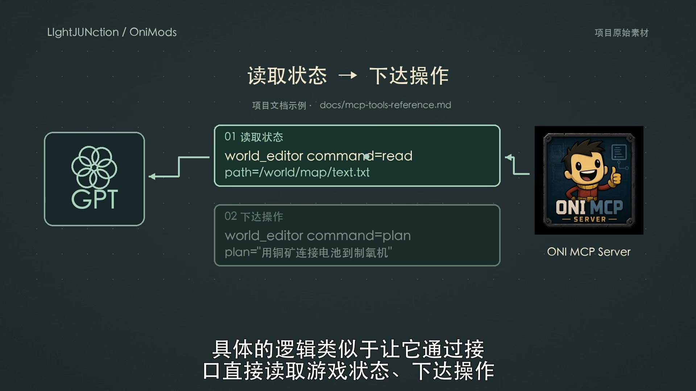
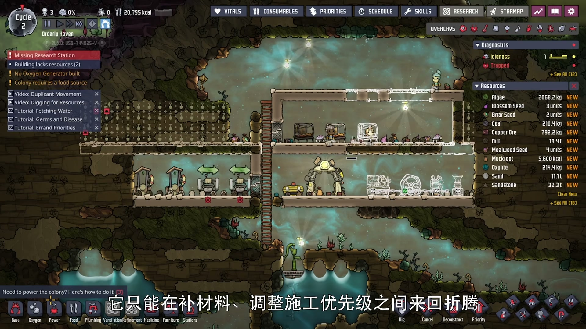
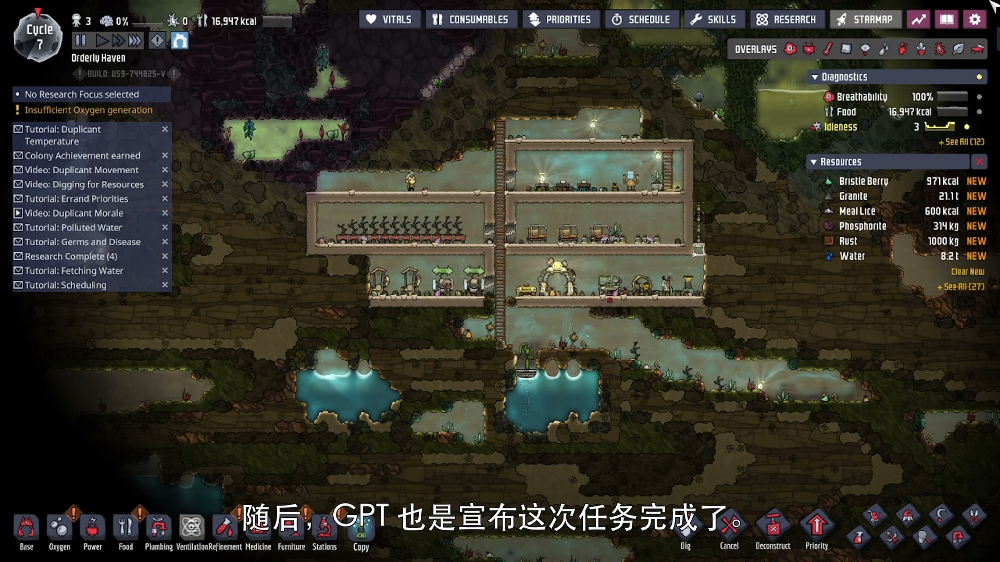

# OniMcp

OniMcp 把正在运行的《缺氧》开放为本地 MCP 服务，让支持 MCP 的客户端读取殖民地状态、定位问题，并调用明确的游戏操作。Mod 提供接口；模型与客户端由你选择。

本文介绍 **OniMcp 0.2.11** 的功能与改进。使用时需要启用 **Jlib 0.3.10 或更新的兼容版本**。多个依赖 Mod 共用一份 Jlib。实际安装包与客户端支持范围请分别核对。

打开打印舱后，用 `building_control` 的 `list_immigrants` 查看本轮候选人和属性。对选中的 `candidateId`，先用 `claim_duplicant` 和 `dryRun=true` 预览，再用 `confirm=true` 招募。补给包继续使用 `list_rewards` 和 `claim`。

在天然地块上规划地板或建筑时，一次地图编辑即可安排挖掘和后续建造。回执中的 `pendingStatusRead` 可以直接交给 `world_editor`，一次查询最多 128 项，查看各格坐标、状态和当前阻塞原因。

## 从这里开始

1. 订阅并在游戏的 **Mods** 菜单启用 [Jlib](https://steamcommunity.com/sharedfiles/filedetails/?id=3835083839) 和 [OniMcp](https://steamcommunity.com/sharedfiles/filedetails/?id=3807166922)，重启游戏。
2. 将 MCP 客户端连接到 `http://localhost:8788/mcp/`。浏览器状态入口是 `http://localhost:8788/`。
3. 先发现当前会话的工具与资源，再读取状态。殖民地数据需要已经载入存档；地图准备好后才能读取殖民地数据。

服务使用 MCP `2025-11-25`：先 `initialize`，后续会话请求携带服务返回的 `Mcp-Session-Id` 和 `Mcp-Protocol-Version: 2025-11-25`。正常 MCP 客户端应完成这些步骤。具体连接配置见[客户端接入指南](../../docs/api-developer-guide.md)。

## 先读，再决定做什么

当前公开工具只有七个。通过 `tools/list` 查看本次加载的实际参数，不要调用已退出公开接口的 `read_control`。

| 入口 | 用途 |
| --- | --- |
| `world_editor` | 像浏览目录一样列出、搜索、读取世界数据，并执行支持的编辑 |
| `game_control` | 暂停、速度、受限时长推进和其他游戏控制 |
| `navigation_control` | 镜头、叠加层和截图 |
| `building_control` | 建筑规划、放置与设施操作 |
| `orders_control` | 挖掘、清扫、拖地、拆除等任务 |
| `server_control` | 服务状态、目录与任务管理 |
| `benchmark` | 工具调用路径的测量与诊断 |

三个常用读取：

- 完整当前状态：`world_editor command=read path=/active/colony/current.oni`。
- 指定格子的结构化信息：`resources/read`，参数 `{"uri":"oni://world/cell/81/111"}`。坐标请换成当前地图中的格子。
- 可继续探索的格子文档：`world_editor command=read path=/active/map/cell_81_111.md`。

`oni://tools/manifest`、`oni://tools/guide`、`oni://colony/status` 和 `oni://resources/inventory` 是其他常用资源。用 `resources/list` 与 `resources/templates/list` 发现当前提供的 URI。

当前状态的目录预览保留完整 JSON 结构，并给出完整文档入口；它只包含摘要；完整结果通过文档入口读取。工具返回的下一步提示仍需服从本次会话的公开工具与资源清单。

## 多组分数据怎样读

启用提供多组分库存的 Mod 后，格子资源中的 `multicomponent` 会给出提供者可用性、完整组分及其质量和温度。没有快照时返回 `available=false` 和原因，请先检查可用性，再解释格子内容。

压力和体积分数另有可用性字段。当前 OniSim 尚未计算校准后的气液压力与分压，因此接口明确报告不可用；解释这些字段前请检查可用性标记。液体占格比例按求解器的标称容量计算，是占格份额；压力则使用 kPa。客户端应先检查 `pressureAvailable`、`liquidVolumeFractionAvailable` 及各组分的对应字段。

## 连接与操作边界

默认监听本机，`AuthEnabled=false`。如果改为非回环地址，必须启用认证；缺少认证时服务拒绝这种监听配置。Bearer token 负责访问认证，不会加密传输。跨机器使用应通过你配置的 VPN 或 TLS 反向代理，后端保留回环监听。

设置文件为 `OniMcpConfig.json`，配置项与加载逻辑见[实现](ModInfo.cs)。修改后按选项中的重启服务操作或重启游戏。客户端对读档、重启和大范围世界修改应先说明操作范围并征得用户同意。

## 验证范围

本轮已在 U60 实机检查公开七入口发现、当前状态 JSON 和格子读取；独立宿主覆盖了协议校验、后台任务响应及公开续读路由。当前状态与公开读取提示的定向宿主回归通过 50 个断言，但宿主中的游戏处理器使用替身。

最新六处后续提示修正已提交，实机复查尚待完成。其余工具、第三方客户端及长时间自主游玩仍需分别验收；游戏帧率需另行实测。细节见[更新记录](CHANGELOG.md)、[协议兼容说明](../../docs/mcp-protocol-retirement.md)和[接口核验脚本](../../scripts/verify_onimcp_tool_surface.py)。

## 演示与反馈

以下为仓库保留的历史演示图，展示的是历史操作场景：

反馈请附游戏版本、Mod 版本、调用参数、错误返回和最小复现步骤，并移除日志中的令牌、私人地址及其他账号信息。[提交问题](https://github.com/LIghtJUNction/OniMods/issues)。

支持开发与测试：[捐助](https://donate.lmm.best/?project=onimcp)。

## 来源

OniMcp 属于 [OniMods](https://github.com/LIghtJUNction/OniMods)，开发和发布流程见仓库文档。项目采用 AI 辅助生成与迭代；[MCP](https://github.com/modelcontextprotocol)、[Harmony](https://github.com/pardeike/Harmony)、[PLib](https://github.com/peterhaneve/ONIMods) 等第三方代码、规范和游戏素材保留各自作者与许可，不归入本项目的原创 AI 内容。
