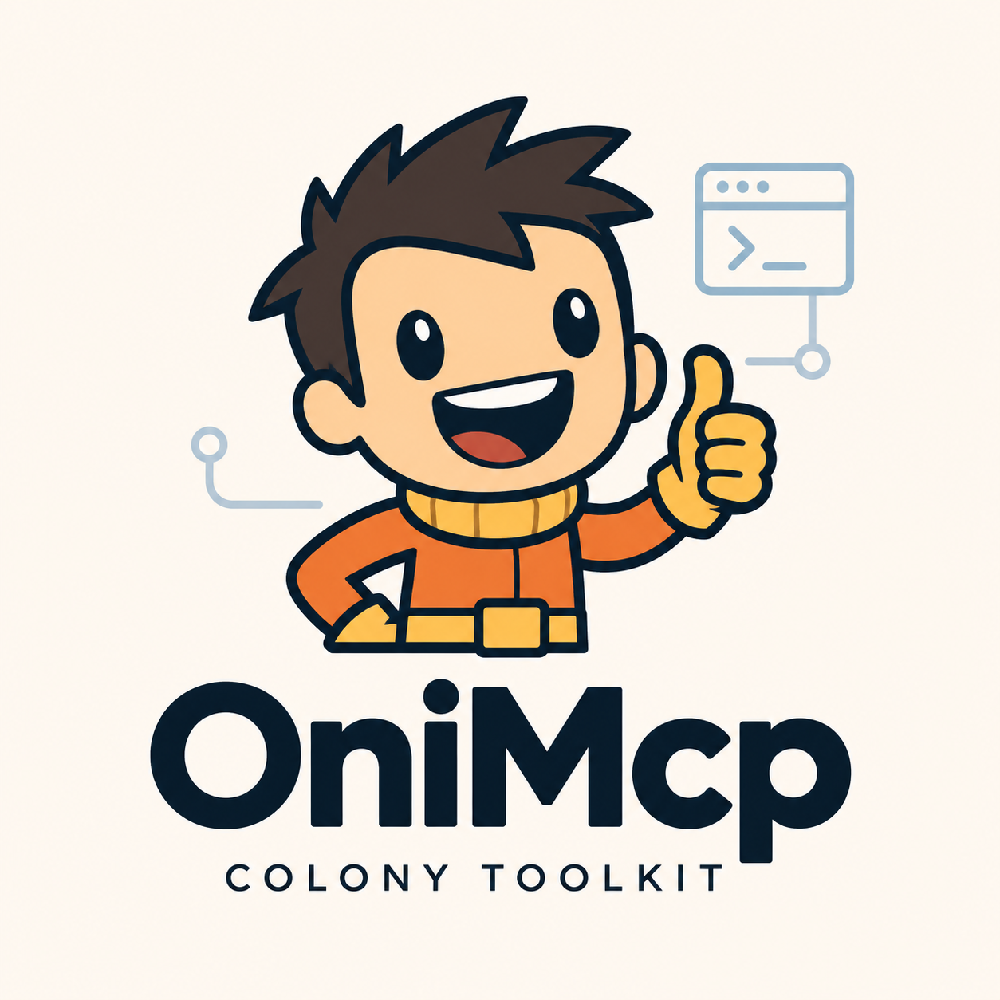
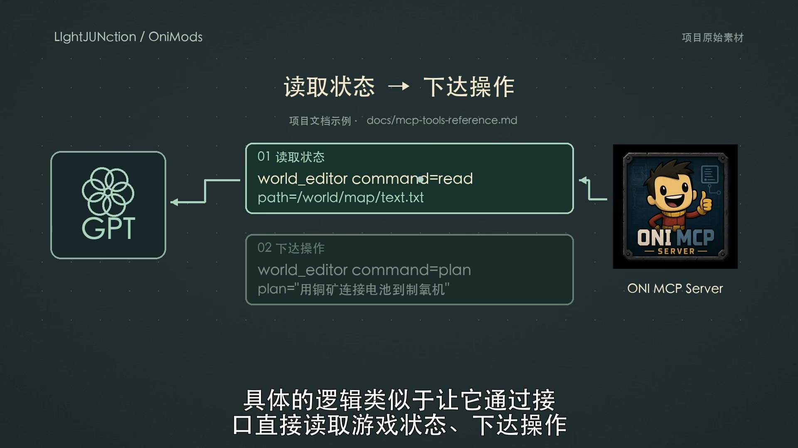
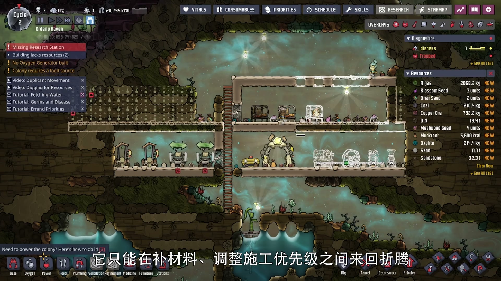
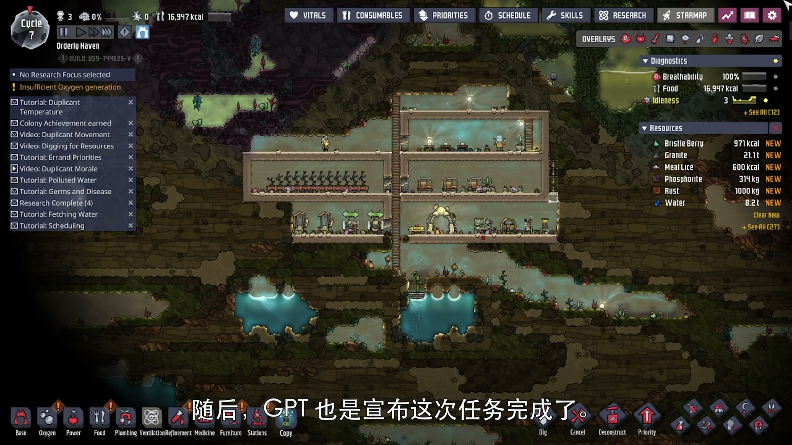

# OniMcp

OniMcp exposes a running **Oxygen Not Included** game as a local MCP service. A compatible client can inspect a colony, investigate a problem, and request explicit game actions. The mod supplies the interface; you choose the model and client.

This README describes **OniMcp 0.2.10**, which requires an enabled **Jlib 0.3.10 or a newer compatible provider**. Dependent mods share one Jlib installation. Check the installed package and your client's support separately.

After opening the Printing Pod, use `building_control` with `domain=side_surface surface=facility kind=printing_pod action=list_immigrants` to inspect the current candidates and their stats. Preview your chosen `candidateId` with `claim_duplicant` and `dryRun=true`. Recruit with the same ID and `confirm=true`. Use `list_rewards` and `claim` for care packages.

## Start here

1. Subscribe to and enable [Jlib](https://steamcommunity.com/sharedfiles/filedetails/?id=3835083839) and [OniMcp](https://steamcommunity.com/sharedfiles/filedetails/?id=3807166922) in the game's **Mods** menu, then restart.
2. Connect your MCP client to `http://localhost:8788/mcp/`. The browser status page is `http://localhost:8788/`.
3. Discover this session's tools and resources before reading state. Colony data requires a loaded save; a service responding in the main menu does not mean a map is ready.

The service supports MCP `2025-11-25`. Call `initialize`, then send the returned `Mcp-Session-Id` and `Mcp-Protocol-Version: 2025-11-25` on session requests. A conforming MCP client should handle this exchange. See the [client integration guide](../../docs/api-developer-guide.md).

## Read first, then choose an action

Seven tools form the public interface. Use `tools/list` for their current parameters. `read_control` is no longer a public tool.

| Entry | Purpose |
| --- | --- |
| `world_editor` | List, search and read world data through virtual paths; perform supported edits |
| `game_control` | Pause, speed, bounded simulation advance and other game controls |
| `navigation_control` | Camera, overlays and screenshots |
| `building_control` | Building plans, placement and facility controls |
| `orders_control` | Digging, sweeping, mopping, deconstruction and related orders |
| `server_control` | Service status, catalog and task management |
| `benchmark` | Measurement and diagnostics of tool call paths |

Useful starting reads:

- Complete current state: `world_editor command=read path=/active/colony/current.oni`.
- Structured cell data: `resources/read` with `{"uri":"oni://world/cell/81/111"}`. Replace the coordinates with a cell in your map.
- A cell document with further reads: `world_editor command=read path=/active/map/cell_81_111.md`.

Other starting resources include `oni://tools/manifest`, `oni://tools/guide`, `oni://colony/status` and `oni://resources/inventory`. Discover URI templates with `resources/list` and `resources/templates/list`.

The directory's current-state preview remains valid JSON and points to the complete document. A preview is not the full result. Follow-up guidance must still match the tools and resources exposed by the current session.

## Reading multicomponent cells

When a mod provides multicomponent inventory, the cell resource's `multicomponent` object reports provider availability and all published components, including mass and temperature. Without a snapshot it returns `available=false` and a reason. Missing data does not mean an empty cell.

Pressure and volume fractions have separate availability fields. The current OniSim provider does not supply calibrated gas/liquid pressure or partial pressure; those quantities are unavailable. Do not interpret a missing value, or an older zero placeholder, as a vacuum. Liquid occupancy is calculated from the solver's nominal capacity; it is not a measured geometric volume or a pressure in kPa. Check `pressureAvailable`, `liquidVolumeFractionAvailable` and the corresponding component flags first.

## Connection and action boundaries

The default listener is local, with `AuthEnabled=false`. A non-loopback listener requires authentication; the service rejects that configuration without it. A Bearer token authenticates access but does not encrypt traffic. For remote access, use a VPN or TLS reverse proxy you configure, retaining a loopback backend.

Settings are in `OniMcpConfig.json`; see the [implementation](ModInfo.cs) for configuration and precedence. Restart the service through its options or restart the game after changes. A client should explain and obtain user approval for loading saves, restarting, or making large world changes.

## Validation scope

This iteration checked discovery of the seven public tools, current-state JSON and cell reads in a U60 game. Separate hosts exercise protocol validation, background task responses and public continuation routing. The focused current-state/public-read regression passed 50 assertions, with game handlers stubbed.

The latest six follow-up hint corrections are committed; their game recheck remains pending. These checks do not validate every tool, every third-party client or long autonomous campaigns, and do not establish an FPS improvement. See the [changelog](CHANGELOG.md), [protocol compatibility record](../../docs/mcp-protocol-retirement.md) and [interface verification script](../../scripts/verify_onimcp_tool_surface.py).

## Demonstrations and feedback

These retained images show historical repository demonstrations, not this iteration's U60 acceptance run.

Please include the game/mod versions, request arguments, error response and a minimal reproduction in an [issue](https://github.com/LIghtJUNction/OniMods/issues). Remove tokens, private addresses and account details from logs.

Support development and testing: [Donate](https://donate.lmm.best/?project=onimcp).

## Sources

OniMcp is part of [OniMods](https://github.com/LIghtJUNction/OniMods); development and release instructions live in that repository. The project uses AI-generated development and iteration. Third-party code, specifications and game assets, including [MCP](https://github.com/modelcontextprotocol), [Harmony](https://github.com/pardeike/Harmony) and [PLib](https://github.com/peterhaneve/ONIMods), retain their authorship and licenses.
