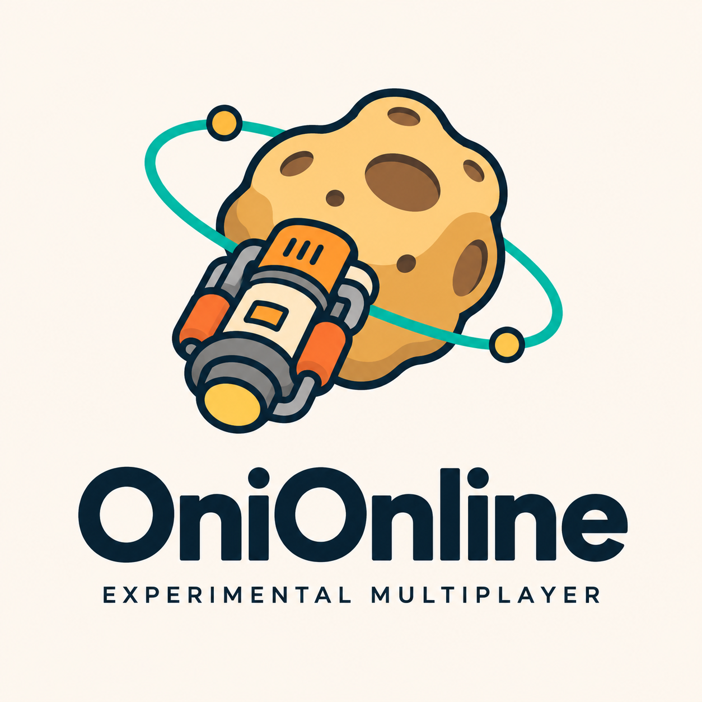

# OniOnline — 大厅、聊天与联机开发框架



OniOnline 的默认玩法是 **ChatOnly**：提供大厅、连接会话和文字聊天。世界观察、原生行星入驻等服务需要另一个玩法 Mod 主动注册、选择并声明能力；单独安装本包不会开启完整多人殖民地模拟。

本文介绍 **OniOnline 0.5.3** 的功能与改进。网络协议为 **11**，配套使用 Jlib 0.3.10；工坊安装版本以实际安装包为准。

## 先把大厅用起来

先订阅并启用 [Jlib](https://steamcommunity.com/sharedfiles/filedetails/?id=3835083839) 与 [OniOnline](https://steamcommunity.com/sharedfiles/filedetails/?id=3835145552)，重启游戏。基础会话不要求安装 CycleTrim，也不以拥有 DLC 为前提。

当前源码接通了以下操作路径；**本轮新增入口的 U60 实机与双端验收尚待完成**：

1. 主菜单点击 **浏览大厅**。可筛选 Steam / 局域网，或输入大厅码。
2. 选择 **创建大厅**，进入连接表单。填写昵称和大厅名称；在 **网络设置** 中选择传输方式、局域网端口和可选密码，再点 **创建大厅**。
3. 房间中复制大厅码给参与者。对方使用浏览页或大厅码加入，聊天玩法成功连接后进入同一个房间界面。
4. 已连接并载入殖民地后，通过管理栏气泡 **通讯** 或默认 **Ctrl+T** 打开聊天；**Esc** 关闭。快捷键可在游戏中重绑定。未连接时不显示聊天 HUD。

新入口复用原有创建与握手逻辑。连接状态会区分正在尝试、等待下次重连和最终失败，并保留原因。聊天发送失败会保留输入，便于重试。SDK 发送成功的语义是传输层接受了消息。远端处理与逐个参与者的送达确认，需要调用者自己的协议。

## U60 的能力边界

这里的“可接入”描述源码路径，两个真实游戏客户端的本轮验收仍待完成。

| 流程 | 当前默认包 / U60（763796） |
| --- | --- |
| 浏览、创建、按码加入大厅 | 不受 744825 原生适配门禁限制；新建入口及加入后的房间跳转已接通，实机验收待完成 |
| 大厅文字聊天、成员列表、断线重连 | 使用独立会话层；已有宿主网络回归，未完成本轮 U60 双端实机验收 |
| Mod 清单核验与兼容性协商 | 有独立会话路径；启用及重启由玩家确认，状态通道由 Mod 明确注册 |
| 已注册的 SDK 消息/状态通道 | 由相应 Mod 声明及启用；默认聊天包没有额外游戏玩法 |
| 原生行星、世界观察、远程工作相关世界服务 | **U60 不可用**；适配白名单仍只有游戏构建 744825 |
| 原生星图协作 | **U60 不可用**；还要求 744825、Spaced Out! 和显式启用对应玩法 |
| 完整殖民地迁移、复制人或资源运输、火箭运输、离线追赶 | 默认包未提供可用的完整玩法流程 |

世界观察不可用时按钮禁用并显示原因；运行时也会在关闭窗口之前拒绝请求。U60 对应的错误为 `native_adapter_unavailable`，界面提示“当前游戏版本尚未支持此功能。”。聊天模式在受支持旧版本上也不会自动获得世界服务。

白名单依据在 [SessionCompatibility](Network/SessionCompatibility.cs)。构建 744825 的基础游戏可声明原生行星和观察能力，Spaced Out! 另可声明原生星图能力；这只是受审查适配器范围，仍须有玩法 Mod 选择这些服务。元数据中的最低游戏版本不表示所有后续版本都支持原生功能。

## Mod 一致性与传输

连接时核验所需 Mod 的来源、版本、内容哈希和加载状态；重连后重新确认。未声明策略的 Mod 按必需处理。不一致时使用原生界面提示；来自公开工坊的内容可以走相应下载流程，下载后仍需玩家确认启用，并在需要时重启加载。

本地开发 Mod 不会被自动上传给别人。状态同步只覆盖注册的通道，不复制任意 Mod 内存，游戏物资、复制人和存档转移需要另行实现相应流程。

局域网默认 TCP 端口为 `27140`，发现端口为 UDP `27141`：

- 局域网直连：`oni://IP:27140`。
- Steam 大厅：`oni://steam/<lobby id>`。
- 局域网链路面向可信网络；大厅密码不加密 TCP 数据。跨公网使用应另行配置受信网络通道。

语音默认 **Ctrl+V** 按住说话仍属开发能力，麦克风、焦点切换和双端体验未完成验收，目前保留为开发能力。

## 给玩法 Mod 作者

在 `OnLoad` 注册 `GameplayFramework.Register`，并在连接前选择玩法。默认只注册 `onionline.chat`。需要世界服务的玩法声明 `onionline.worlds.v1` 并满足原生能力协商；声明能力不能绕过本机适配门禁。

`OnePlanetPerPlayer` 是可复用 SDK 规则，不是默认注册的完整多人玩法。`OniOnline.Framework` 是 `netstandard2.0` 的独立程序集，不依赖 Unity、ONI 或 PLib。

- [SDK](docs/SDK.md)
- [兼容性契约](docs/FRAMEWORK-COMPATIBILITY.md)
- [Mod 同步 SDK](docs/SDK-MOD-SYNC.md)
- [Mod 内容同步](docs/MOD-CONTENT-SYNC.md)
- [构建、安装与测试](docs/build-install-test-zh.md)

## 已验证与未验证

本轮干净源码快照的独立宿主通过 **4,808 个断言**。覆盖真实回环 TCP、三个独立客户端进程、限流/延迟、断线重连、会话生命周期及保存失败处理。网络压力场景为每方向 2,048 B/s、每个代理数据块 160 ms ± 70 ms 延迟与 2,000 格地图。游戏世界和时间边界使用替身。

这些结果覆盖被测会话路径；**U60 两台机器或两个真实游戏客户端的多人验收仍待完成**。世界观察与原生行星在 U60 仍由适配门禁禁用。新的大厅 UI 入口、Steam 下载流程与语音体验须分别实机检查。

源码构建需要合法安装的游戏引用；从仓库按构建文档运行。纯 SDK/宿主回归可使用：

```sh
dotnet run --project tests/OniOnline.Tests/OniOnline.Tests.csproj -c Release -p:ImportDirectoryBuildProps=false
```

该命令从 OniMods 仓库根执行。探针构建仅用于开发，不进入普通发行包。测试未知玩法前保留存档副本。

## 图示、来源与反馈

手绘图说明框架与工具链，具体玩法状态见上方能力表：


<p align="center"></p>

项目采用 AI 生成开发与迭代。第三方库和原版游戏素材保留原作者及许可，见[第三方声明](THIRD_PARTY_NOTICES.txt)。[反馈问题](https://github.com/LIghtJUNction/OniMods/issues)时请提供双方版本、所选玩法、传输方式与错误码；移除大厅密码、私人地址和账号信息。
